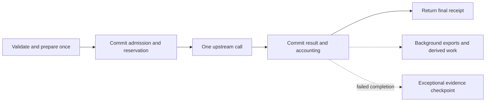

# Efficient execution: technical design

Status: shared application changes, capture/runtime refinement and local activation are implemented. Six co-located Linux cohorts meet the server-overhead p95 target; the sequential SQL budget, full CI and hosted qualification remain open. The [verification record](execution-efficiency-verification.md) retains passed checks and missed targets without claiming completed performance or hosted acceptance. [Feature specification](execution-efficiency-feature-spec.md) defines outcomes and the durability tradeoff; [central TODO](../maintainers/TODO.md#execution-efficiency-redesign) tracks the open gates. Current behavior remains in the decision, billing and runtime feature owners.

## Design decisions

1. Use two normal execution commits for immediate inference: compact admission, then combined response/accounting completion. Use an exceptional evidence checkpoint after recoverable completion failure. Keep final money and result semantics synchronous; move diagnostics and derived administration off the path.
2. Do not synchronously persist full immediate input for a recovery engine that is forbidden to redispatch it. Queued work still persists executable input before acceptance. Store successful output once before claiming durable replay.
3. Keep typed domain policy in existing TypeScript owners. Use narrow projections, set-based mutations and explicitly ordered driver pipelines to reduce round trips. Do not move the entire authorization/billing engine into stored procedures to advertise “two queries.” A small SQL routine needs a measured remaining dependency bottleneck and one policy owner.
4. Cache immutable data by version/digest; verify mutable authority and funding at their authoritative boundary. A rate snapshot can live in memory indefinitely for its version; current eligibility cannot.
5. Keep resource limits independent: request bytes, buffered memory, DB admission, provider requests, native provisioning, transfers, stream readers and background work. No promise of thousands of customers follows from one large concurrency number.

## Path inventory and owning changes

These are source-traced opportunities, not measured speedup claims. Paths named below and their direct callers are the execution scope; unrelated CRUD, payment processing and marketing UI are not being redesigned.

| Path and owner                                                                | Current avoidable work                                                                                                                                 | Planned change and preserved boundary                                                                                                                                                                                              |
| ----------------------------------------------------------------------------- | ------------------------------------------------------------------------------------------------------------------------------------------------------ | ---------------------------------------------------------------------------------------------------------------------------------------------------------------------------------------------------------------------------------- |
| HTTP/REST/customer MCP: `http.ts`, web REST/MCP hosts                         | Separate authentication, rate, early replay and admission transactions; diagnostic hooks can retain synchronous CPU/I/O                                | Keep early abuse protection and cheap replay before new-execution checks; combine compatible reads and reuse authenticated preparation facts. Both hosts retain one producer and use the same background owner                     |
| Immediate: `inferences.ts`, `direct-inference.ts`, `inference-invocations.ts` | Large context plus encrypted request stored before dispatch; three execution commits; many helper SQL round trips                                      | Compact admission and combined completion; no full input persistence requirement; fresh current-state checks, exact binding, one dispatch permit and same-key recovery                                                             |
| Native admission: `runs.ts`                                                   | Fresh-session config validated twice; full session/worktree records reread; detailed advisory queue observations calculated during admission           | Prepared immutable config reused; project only needed revisions/control facts; one current commit check; optional queue detail after acceptance. Persist executable input and writer/queue/funding ownership                       |
| Queued dispatch: `portable-dispatch.ts`, `engine.ts`, `cloud-engine.ts`       | Candidate selection repeated by resource class; full Run loaded at entry and phase claim                                                               | Share a bounded candidate observation where fair ordering permits; return required state from phase claim. Eligibility remains a hint until fenced admission; maintain independent progress pools                                  |
| Native model call: `model-gateway.ts`                                         | Full Run and separate budget rereads; request preparation and trace attribution within admission                                                       | Narrow locked control snapshot including budget; immutable protocol preparation before locks; shared transaction-aware accounting. Persist first model-error fence before allowing subsequent paid calls                           |
| Large model body: `model-request-upload.ts`                                   | Awaited staging DELETE before provider dispatch                                                                                                        | Retained bounded cleanup plus lifecycle expiry; signed claim, authenticated decrypt, exact bytes/hash and ordinary model authorization stay synchronous                                                                            |
| Brokered tools: `tool-broker.ts`, `connections.ts`                            | Each call authorizes repeatedly, rediscovers every granted connection, initializes/closes those clients, then initializes another client for execution | Revisioned schema/catalog cache and direct selected-tool lookup; one authoritative admission after preparation; exact credential/grant check; durable call key before effect; no ambiguous retry                                   |
| Bounded agent: `inference-engine.ts`, `bounded-decisions.ts`                  | Ready steps require separate advances; per-call 500 ms full-Run authorization polls                                                                    | Continue ready finite steps in one retained execution owner after their durable boundaries; share batched control observation. Preserve durable input/read-context evidence, aggregate budgets and generation fencing              |
| Hydration: `cloud-engine.ts`, `execution-hydration.ts`, provider `storage.ts` | Entire inventory reread every 16 entries; sequential descriptions and per-chunk transactions; simple stored files uploaded again during description    | Revision-bound paged input metadata; bounded concurrent descriptions; bulk chunk/progress writes. Reuse existing verified chunk identity for single-chunk objects, then verify restoration normally                                |
| Checkpoint: `cloud-engine.ts`, `files.ts`, provider `storage.ts`              | Four uploads/pass with individual progress writes; manifests verified then same content verified again during publication                              | Byte/concurrency-bounded batch and one progress commit; reuse exact verified-content facts within the storage-protected publication. Keep writer quiescence, full-file integrity and durable Session publication                   |
| Warm placement: `host-allocations.ts`, `worker-placement.ts`, Host controller | Placement supplies empty warm-harness lists and zero retained memory despite resident runtime handles                                                  | Bounded content-free health observations keyed to host generation/boot, Session/checkpoint revisions and compatibility. Placement hint only; controller revalidates. Automatic isolated allocation keeps its different warm policy |
| Native events/SSE: `cloud-engine.ts`, `events.ts`, runtime event buffers      | Two-second runtime polling plus 750 ms public polling; sequential SQL per ingested event                                                               | Batch ordered ingestion; content-free wake hints and shared reader observation with repair polling. Replay/retention/terminal semantics stay durable, not per-token SQL                                                            |
| Observability/reporting: `run-tracing.ts`, `events.ts`, billing/read models   | Duplicate payload encoding/attribution and synchronous report construction                                                                             | Reuse accepted descriptive attribution; prepare/export bounded diagnostics outside critical commits; read final receipts directly from canonical financial/result facts                                                            |

Sources: [HTTP](../../packages/core/src/http.ts), [admission](../../packages/core/src/inferences.ts), [direct owner](../../packages/core/src/direct-inference.ts), [native admission](../../packages/core/src/runs.ts), [gateway](../../packages/core/src/model-gateway.ts), [tools](../../packages/core/src/tool-broker.ts), [cloud phases](../../packages/core/src/cloud-engine.ts), [storage](../../packages/providers/src/storage.ts), [events](../../packages/core/src/events.ts). These contain the detailed existing authorities; do not create parallel implementations for each delivery mode.

Task and trigger entry points are also in scope: [Task admission](../../packages/core/src/decision-tasks.ts), [Task progression](../../packages/core/src/decision-task-engine.ts) and [trigger dispatch](../../packages/core/src/trigger-dispatch.ts). Task progression currently reschedules active work after five seconds and depends on a two-second maintenance cadence; child completion does not wake its parent directly. Trigger admission and slow Slack replies share four awaited slots. Both are concrete progress delays, distinct from model inference time.

## Shared contracts and safe defaults

Optimize the owning operation, then move its callers onto that operation in the same stage. An efficient direct-inference branch beside an unchanged shared helper is not completion. Extend the existing modules below; names describe concrete contracts, not new services or a generic execution framework.

| Owner                                                                 | Required interface and default behavior                                                                                                                                                                                                                                                     | Boundary retained by callers                                                                                                                                                                                                                          |
| --------------------------------------------------------------------- | ------------------------------------------------------------------------------------------------------------------------------------------------------------------------------------------------------------------------------------------------------------------------------------------- | ----------------------------------------------------------------------------------------------------------------------------------------------------------------------------------------------------------------------------------------------------- |
| `packages/db` `transaction`/`transact`, `budgetedClient`              | Extend the existing transaction owner for bounded independent query groups. It owns tenant/storage setup, cumulative deadlines, ordered drain, rollback, uncertain commit classification and after-commit hooks. Domain operations accept the caller's `Tx` and return narrow typed facts.  | The domain coordinator chooses transaction boundaries and dependency/lock order. A composable helper never opens another domain transaction or commits its caller's transaction. Independent OAuth refresh remains its existing deliberate exception. |
| `inference-invocations.ts`, `inferences.ts`, `direct-inference.ts`    | Reuse `PreparedInvocation` for immutable prepared bytes/digests/terms; separate it from the small current control projection. Admission returns a discriminated replay, existing-in-progress or confirmed-dispatch result. Only that last branch carries the process-local dispatch permit. | Preparation is not authority; recovery and replay cannot construct a dispatch permit. Immediate and queued admission retain different input-durability requirements.                                                                                  |
| `model-gateway.ts` and `ledger.ts`                                    | Extend existing `settleModelRequestInTransaction`; retain `settleModelRequest` as its transaction-opening convenience wrapper. One owner calculates usage, provisional/provider cost, charge, journal and budget changes and returns the same small billing facts to every caller.          | Immediate completion composes settlement with final publication; bounded completion composes it with step evidence; native completion settles one request without terminalizing its parent Run.                                                       |
| `events.ts`                                                           | One transaction-aware batch append operation owns ordered sequence allocation, producer deduplication, event rows and associated webhook obligations. Existing `emit` becomes its one-event wrapper. Native ingestion and `durableInferenceOutput` use the batch form.                      | The phase owner supplies the generation fence and commits its source cursor in the same transaction. Stream delivery remains separate from durable append; a batch must preserve per-event behavior.                                                  |
| `connections.ts`, `connection-access-resolution.ts`, `tool-broker.ts` | `connectionTools` reuses a raw catalog snapshot with stable schema objects, while projecting current grants separately. `runtimeConnectionTools` remains the authority owner; `executeGrantedTool` remains the effect/budget owner. Selected-tool resolution uses these same operations.    | Authenticate and authorize before private discovery, then recheck current authority after preparation and before the effect. A cached catalog or exposed tool name never grants access.                                                               |
| Storage verifier, `storage-preparation.ts`, `files.ts`                | One verifier produces the guarded verified-content result consumed by `prepareCheckpoint`; callers cannot assert verification with a boolean or reconstructed record. Public storage/provider ports retain their existing trust boundary.                                                   | Publication supplies current ownership/revision/fencing and an active storage guard. Proof reuse is confined to that guard and content identity; recovery verifies again.                                                                             |

Keep large input and result loads explicit. Hot control/financial helpers return their named projections, not an apparently convenient full `RunRow`; do not spread copied projection strings or reconstruct that full type with empty/default payload fields. Payload readers are separate, tenant-authorized operations. For inference output, use the existing invocation response store as the single content owner, with small status/receipt/reference facts on the Run. Normal completion and exceptional checkpoint populate the same representation. Shared inference presentation reads this owner for HTTP, MCP, replay and history; list consumers needing content use bounded bulk reads, not one new query per Run. Preserve each public representation until an intentional contract update changes it.

Do not merge unlike semantics to make the diagram look uniform. Tool fixed fees at dispatch, model usage settlement, native checkpoint completion and Task allocation ceilings are different operations. MCP schema validation supports its declared dialects; inference schemas deliberately support a restricted subset. Keep those policy owners separate. Likewise, catalog invalidation, optional diagnostics and durable jobs have different lifetimes. Share their established primitives where useful, not a flag-driven universal cache, scheduler or executor.

The extension test is a new protocol adapter or execution caller: it should supply protocol preparation/response normalization and its own continuation decision, then reuse existing current-state admission, transaction-aware settlement and event/result publication. It must not copy financial SQL, create another transaction manager, choose a custom result store or rely on remembering a performance flag. Acceptance must demonstrate reuse across immediate, bounded and native callers; similar function names alone are not evidence.

## Immediate lifecycle

### Prepare outside locks

Authenticate early enough to protect referenced data and apply existing abuse limits. Read bounded bytes and validate/fingerprint before the replay decision below. For genuinely new execution, resolve referenced immutable content with current access, select the exact protocol/credential binding and prepare provider bytes/digests once. Never treat identical content as a duplicate invocation: idempotency keys identify intent; two different keys are two intentional calls.

After pure request-shape validation/fingerprinting and current read authorization, resolve existing identity **before** new-execution capacity, producer-permit acquisition, credential resolution, model eligibility or catalog refresh. Keep the cheap replay lookup, combining it with compatible early checks only when their ordering/role permits. A completed result remains readable if its old provider key was rotated or model disabled, provided the caller still has result-read authority. Retain changed-fingerprint conflicts and purge tombstones. Active same-key requests likewise return their existing receipt under saturation. A still rechecks identity atomically for races; deleting the early lookup is not a performance goal by itself.

Rate/catalog refresh, context reads and independent OAuth refresh happen outside the money/capacity transaction. Return revisions and digests for revalidation. Cache schemas and rates as described below. Prepare output validation/encryption outside completion locks too. Do not add new serial preparation RPCs for inline managed calls.

### A: compact admit and reserve

Under the existing tenant context and established lock order:

1. Resolve key/fingerprint atomically; an existing identity returns its authorized state/result, never another dispatch permit. The early lookup avoids new-execution checks for known identities; this second check resolves concurrent first submissions safely. Release any newly acquired producer permit on a duplicate. No duplicate requires new durable execution capacity.
2. Recheck principal, organization, relevant resource/reference grants, current holds, route eligibility, exact credential revision, limits and accepted deadline after waits. A prior authentication or cache hit is preparation, not authority.
3. Reserve the accepted maximum and claim capacity atomically. Keep organization/global/worktree semantics shared with other owners. No large body or external I/O occurs while the global lock is held.
4. Persist compact Run/invocation/gateway identities, frozen small terms, generation, dispatch state, deadline and recovery fence. Reuse existing tables; a separate generic operation store is unnecessary. Insert required compact lifecycle events in the same batch; eliminate diagnostic product-event work from A.
5. Commit and release the connection. Only the original owner with confirmed commit acknowledgment gets the in-memory dispatch permit. A readback after a lost acknowledgment never grants one.

The dispatch intent means “this exact authorized operation may already have reached the provider.” It is not a full request copy, another task or an instruction to redispatch. The duplicate identity is `(organization, existing operation scope, idempotency key)` plus the request fingerprint. These records prevent a lost response or retry from buying the same request twice.

Recovery scheduling is one compact indexed identity/fence using the existing dispatch job, inserted with A. Successful completion marks it done in the completion batch. Recovery execution happens later. Replacing this with an unbounded scan of all Runs to save one small write is not an optimization.

### Provider execution

Release every DB connection and lock. Execute once with frozen terms and exact credential, using existing transport pooling, deadline and redirects/size policy. Forward supported deltas without token-by-token storage while assembling the bounded final response. Keep the same producer registered with the host lifetime for JSON and SSE; disconnect detaches delivery. Current cancellation observation remains batched and independent of provider execution.

Full-input history/trace preparation may run concurrently under a bounded background budget. It must not block provider startup, use an unbounded microtask queue, or pin unlimited large buffers. If saturated, omit optional capture and count the omission. Deferred JavaScript CPU still competes on the same event loop; measure it and use the existing batch exporter before considering worker threads.

### F: combined finish and account

Normalize independently valid usage/provider cost and validate the result in memory. Capture trusted completion time at the actual complete-response boundary. Then take the existing Run-first completion locks and:

1. Confirm identity/generation/evidence digest; recheck publication authority, cancellation, reference expiry and retention. Account incurred usage even if output disclosure is denied.
2. Call the single shared model accounting owner. Persist usage, provider cost facts, capped customer charge, model-error fence if needed, balanced journals/credit-lot debits, updated budget and reservation release. A native model completion updates its request and Run counters, not the parent Run's terminal status.
3. Store the immediate usable response and receipt once; publish terminal state and release execution occupancy exactly once. Finish its recovery job. Small terminal events and promised webhook outbox identities can be inserted set-wise here; do not put their delivery or report scans in F.
4. Commit, release the client and return the receipt built from those committed facts. Do not reread the full Run, pricing catalog, history or billing report to assemble it.

Final charges remain final at response time. `billing.provisional` continues to mean uncertain usage/liability, not delayed report construction. BYOK model charge stays zero; provider-reported and estimated costs remain separate. A zero model charge may skip empty wallet journal work only when shared accounting still records the usage, budget cost and idempotent settlement identity and no other outstanding charge requires that mutation.

### Exceptional evidence and recovery

If F definitely rolls back while the owner survives, attempt a bounded evidence-only commit with the already captured response, usage, completion time and the small validation material needed for local finalization. Use the existing completion allowance and generation handoff. Only a confirmed checkpoint permits `finalization_pending`. Recovery performs the same finish locally, never a provider call.

If F's acknowledgment is unknown, read the same completion identity first. If committed, return it; if definitely not committed, the same evidence can retry local finalization/checkpoint within the deadline. If the database remains unavailable, report existing `outcome_unknown`/transport failure semantics; do not assert the response was saved. Hard process death before F or fallback may lose the answer and leave provisional liability. This is the deliberate difference from always checkpointing before settlement.

No public status/error code needs to change merely because F combines two transactions. Update the documented meaning of `finalization_pending`: a confirmed exceptional checkpoint exists. Existing complete/partial/unknown evidence and timely-response rules remain; a timely response must not become a provider timeout because local completion was slow.

## Data and cache boundaries

| Data                   | Target ownership and lifetime                                                                                                                                                                                                                                                                                                                                    |
| ---------------------- | ---------------------------------------------------------------------------------------------------------------------------------------------------------------------------------------------------------------------------------------------------------------------------------------------------------------------------------------------------------------- |
| Hot Run control        | Existing Run ID, tenant, actor/resource IDs, kind/status/generation, deadlines, cancellation/error fences, accounting counters and small accepted terms. Explicit column lists on hot reads/returns                                                                                                                                                              |
| Immediate input        | Owner memory for the request lifetime. Durable digest, binding/reference IDs, audience and expiry; no mandatory full context/provider-body copies                                                                                                                                                                                                                |
| Queued execution input | One durable, retention-owned immutable payload or existing artifact reference before 202; loaded once per owner/generation. Do not replace it with a digest                                                                                                                                                                                                      |
| Frozen terms           | Small accepted customer/provider rates, billing mode, model/route, credential revision and limits. Retain exact values with the invocation; caching does not make historical pricing depend on current configuration                                                                                                                                             |
| Response               | One durable canonical output/evidence representation plus small receipt/provenance. Readers hydrate the public envelope from this owner. Keep the current bounded inline representation initially; use existing encrypted object storage if actual output limits require it, with bytes staged before F and a verified reference committed before final delivery |
| Optional input history | Bounded export to the configured tracing backend under existing content/retention rules. No second unused input-history store or new product API/UI; missing capture is allowed and must not be represented as a fabricated empty prompt                                                                                                                         |
| Projection work        | Existing outbox or deterministic derivation from committed facts; unique `(source identity, revision, projection kind)` processing. No new per-token trace store                                                                                                                                                                                                 |

Change the Run shape constraint so control updates do not repeatedly decompress a huge JSON input. Do not simply remove validation: use typed small control columns/metadata, foreign keys and payload-specific validation at insert/update. Immediate config contains a discriminated compact shape; queued/native input lives in a separate one-to-one payload owner when necessary. Forward migration must preserve developer state and currently admitted execution; drain owned work for activation rather than build a permanent legacy execution mode.

The successful response must not be duplicated in `runs.result`, invocation ciphertext and a history record. Preserve one content owner and normalized independent usage facts; small digests/receipt IDs may repeat. Exceptional evidence can become that final content owner without copying it again. Normalization failures retain bounded raw evidence when available, not unbounded response downloads.

### Compact recovery contract

E1 introduces a concrete discriminated immediate-invocation metadata type rather than retaining an untyped subset of `config`. Its required field groups are:

- Organization, Run/invocation/gateway IDs; initiating actor and optional workspace/reference IDs; original idempotency scope/key fingerprint; generation, state, accepted execution deadline and recovery fence.
- Exact provider/model/protocol version, billing mode and credential binding revision (no secret); frozen retail/provider rate values and original cost/token/output ceilings needed by accounting.
- Input, context and definition digests/revisions; existing context audience/expiry and reference/dependency identities needed for current publication authorization. Keep existing independently bounded metadata limits; if a supported referenced definition/context is large, retain its immutable identity rather than copy it into hot metadata. Do not reject previously valid payloads just to meet a byte target.
- Receipt/provenance fields independent of customer content. The live owner retains output schema/validation rules. Before F or exceptional checkpoint, pure validation produces a typed outcome with validation revision/digest and safe diagnostics; persist that outcome with the response. Recovery consumes it without recompiling a user schema or loading full inline context. If normalization/validation cannot produce an outcome, checkpoint an explicit validation failure plus bounded permitted evidence and independent usage; never pretend the output passed.

Exceptional evidence additionally stores the response digest/content reference, independently normalized usage/provider-cost facts and trusted completion time. Recovery requires no provider credential, live catalog lookup or original prompt. Enumerate receipt/retention/authority consumers against this type before removing old fields; tests must finalize a checkpoint with the original input buffer and vendor credentials absent.

### Versioned caches

Use bounded process-local caches, not a new cache service. A cache miss follows the normal source path; process death loses only an optimization.

- Built-in pricing loads once per application/config version. Dynamic rates cache by provider/model plus immutable catalog revision/digest; refresh uses existing single-flight catalog claims and expiry/backoff. A verifies the current enabled/eligible revision and admitted ceiling. Frozen invocation prices never change after acceptance.
- Retain small rate values in the invocation rather than adding a separate normalized price table solely to save a few bytes. This removes repeated parsing/lookups without introducing joins or unsafe process-only history. Do not promise one global “latest price” loaded forever.
- Compile schemas by canonical digest. Cache definition/artifact bodies only by tenant/resource/audience/revision/digest and bounded bytes, after current authorization. An immutable body cache never authorizes its caller.
- Remote tool catalogs cache by connection ID, endpoint/config revision and credential revision; a server catalog version is optional, not a required MCP capability. Current tool grants and exact credential binding are rechecked at call admission. Explicit refresh, revision changes, `tools/list_changed` where supported and bounded TTL invalidate discovery. Without server notifications/versioning, TTL plus explicit refresh still works. Grant revocation never waits for TTL. Cache misses may fetch only that connection, with bounded single-flight work; no negative authorization cache.
- Never cache available balance, live holds, active occupancy, permission decisions or actor revocation as authoritative. Descriptive trace labels may lag; IDs and accepted versions are enough for attribution. Secrets remain transient under existing credential handling, not a new general cache.

## Database round trips and locks

The requirement is fewer dependency round trips and less transferred work, not merely fewer table names or calls to a helper. Count SQL statements, wire wait groups and commits independently. Initial review budgets for warm stateless inline inference are **two execution commits**, no full-input SQL writes/returns, and at most **12 sequential DB wait groups including HTTP authentication/rate work**. This is a design budget to verify, not a measured result; conditional context/OAuth/catalog I/O and recovery must be reported separately. A budget miss requires a breakdown and owner fix, not hidden queries or weaker guarantees.

| Group             | Composition                                                                                                                                                                                                                                                                                                                           |
| ----------------- | ------------------------------------------------------------------------------------------------------------------------------------------------------------------------------------------------------------------------------------------------------------------------------------------------------------------------------------- |
| HTTP protection   | Reuse current key/membership facts; combine compatible checks/rate mutation in their existing authorization boundary. Keep rate accounting for rejected/invalid traffic. If separate auth-role or rejection-persistent rate transactions remain necessary, show their actual waits rather than calling the entire request two commits |
| A setup           | Queue BEGIN and transaction-local tenant/deadline setup in order on one checked-out client; no protected read precedes setup                                                                                                                                                                                                          |
| A guards          | Acquire locks in the shared audited order; combine each lock with the current row projection where possible. Batch independent reference checks using parameter arrays/joins; do not issue one query per reference                                                                                                                    |
| A mutation        | Set-based identity, reservation, Run/gateway/invocation, event and recovery-job writes. UUIDs/digests already exist in memory; use narrow RETURNING only for generated/current values                                                                                                                                                 |
| A commit          | Await all results, check row counts and policy outcomes, then COMMIT; never prequeue COMMIT                                                                                                                                                                                                                                           |
| F setup/guards    | Same tenant setup; locked Run/gateway/financial facts in dependency order, with needed counters returned by the locking read                                                                                                                                                                                                          |
| F mutation/commit | Combine each affected row's deltas into one update; bulk insert distinct journals/events and update credit lots set-wise in the shared ledger owner. Check all results, then COMMIT and return narrow final facts                                                                                                                     |

The installed `pg@8.23.0` supports opt-in [pipelining](https://node-postgres.com/features/pipelining) on one client. Plain `Promise.all` with the default driver does not eliminate wire waits, and `pool.query` is not a transaction pipeline. Extend `transaction`/`transact` in [the database package](../../packages/db/index.ts) and [its budgeted client](../../packages/db/budget.ts) for declared, bounded independent query groups; do not add a second transaction manager or SQL planning language. Do not enable pipelining globally before testing the budget wrapper, driver timeouts and pooled deployment. Locks, policy decisions and data-dependent writes remain ordered. Drain all submitted results on failure before rollback/release; discard broken/uncertain clients. Preserve cumulative deadlines and commit-ambiguity classification.

[PostgreSQL data-modifying CTEs](https://www.postgresql.org/docs/current/queries-with.html#QUERIES-WITH-MODIFYING) share a snapshot and do not provide arbitrary sibling execution ordering. Do not update the same row twice in sibling CTEs, assume a sibling sees another sibling's write, or infer lock order from an unordered SELECT. Use RETURNING dependencies or ordered statements. Use one [checked-out transaction client](https://node-postgres.com/features/transactions), restricted role and parameterized SQL throughout.

Keep lock policy in existing owners. Before batching, record the actual graph for admission, cancellation, revocation, retention, credit expiry, settlement and queue claiming. Admission currently orders storage/workspace/idempotency/organization and financial checks before global capacity; completion uses Run/gateway before financial settlement. Do not introduce an organization-to-active-Run lock edge to invert completion. Use current revocation fencing, not a newly added key lock in the wrong order.

Remove large input writes from the global capacity critical section. Retain strict atomic global/account admission initially and benchmark hot-tenant and many-tenant contention. Use existing indexed active projections; no terminal history/config scans for occupancy. Replace the global lock only if measured contention remains after this work, with a separately specified atomic capacity allocator and failure/fairness proof. Wallet escrow and sharded permits are not included speculatively.

Financial batching retains earliest-expiring eligible credit allocation, immutable balanced entries, business-event uniqueness, cancellation obligations and current billing holds. Expiration cannot become an eventually consistent spending check: use the locked account's expiry facts or the existing expiry operation before authorizing funds. Moving analytics off the path is not permission to spend expired credit.

## Background ownership

| Class                                                                     | Owner and failure behavior                                                                                                                                                 |
| ------------------------------------------------------------------------- | -------------------------------------------------------------------------------------------------------------------------------------------------------------------------- |
| Required financial/result/replay facts                                    | A/F or native phase publication; not deferred                                                                                                                              |
| Promised webhooks, queued dispatch, recovery, optional requested Git sync | Existing durable jobs/outbox, compact source identity in the source commit; independently recoverable bounded consumer                                                     |
| Derived admin summaries and aggregate reports                             | Rebuild/read from authoritative financial/Run facts, or idempotent revisioned projection jobs when needed. Immediate result/billing APIs do not wait for these projections |
| Request/product analytics, tracing, optional input capture                | Existing bounded retained background lifecycle and batch exporter; may drop under pressure/process death; safe aggregate omission/failure counters                         |
| Temporary upload cleanup                                                  | Bounded retained task, object lifecycle expiry as backstop; no mandatory DELETE round trip before serving                                                                  |

[Next.js `after`](https://nextjs.org/docs/app/api-reference/functions/after) and [Vercel `waitUntil`](https://vercel.com/docs/functions/functions-api-reference/vercel-functions-package#waituntil) retain work only within host lifetime; neither is a durable queue. Use them to accelerate committed jobs or optional diagnostics, never as the sole record of required work. Standalone composition must supply the same bounded ownership/drain semantics.

Separate background concurrency and byte budgets from admission/completion. Stop admitting optional large captures before they threaten memory; recovery/settlement gets headroom. Durable backlog growth needs monitoring and eventual admission backpressure if its safety horizon is threatened. Background does not mean free: measure total CPU, SQL, bytes and export volume as well as response latency.

The host background callback owns lifetime, not capacity. Apply count/byte admission in the tracing or input-capture owner **before** scheduling a closure that retains the request, encoding another copy or creating an export promise. Extend existing trace admission/export rather than placing a generic queue in front of every side effect. Optional input history gets one narrow bounded capture owner; reuse the prepared payload where possible and release its retained-byte budget in every outcome. Both REST and MCP host adapters invoke the same owners. Cleanup retains compact object identities and the existing expiry backstop; durable jobs remain with their current dispatcher. A cap inside the eventual exporter is too late to bound bodies already retained by scheduled callbacks.

## Agent, storage and delivery details

### Native and bounded model calls

Share `prepare → reserve request → provider → settle request` through the existing model credential/protocol/accounting ports. Reuse frozen Run configuration in the confirmed owner; fetch only mutable controls on each call. Prepare byte/token bounds before acquiring locks, then verify binding/revision and reserve under the Run lock. Native streaming forwards bytes immediately but holds the terminal completion boundary until accounting; missing final usage stays provisional. Persist stop-on-model-error before returning failure or admitting another request. Already admitted parallel calls still settle their own liability.

All three model paths use `settleModelRequestInTransaction` or its convenience wrapper, not copied settlement SQL. In bounded execution, `applyBoundedResponse` includes authorized context/storage I/O: save the model-step evidence and settle, release SQL, then perform that external read with its own existing checks and durable next-step publication. A local ready loop does not require one transaction around the whole loop. Native protocol adapters/stream parsers own terminal-tail recognition; the gateway owns the accounting barrier, without reproducing each vendor's framing rules.

The protocol adapter identifies terminal/error frames and trailing usage. Forward ordinary deltas promptly; retain only the bounded terminal tail, consume required usage, commit accounting/error fencing, then forward terminal completion. Do not inject Macrofold `run.*` events into a vendor SSE stream. On settlement failure, end with that protocol's supported error/transport failure and retain the same internal invocation identity for recovery; never emit a successful terminal marker. Cover Responses, chat/OpenRouter and Anthropic framing independently, including split frames and errors followed by another attempted model request. Do not infer that HTTP stream close alone prevents a harness from starting its next turn.

Bounded execution keeps durable intermediate model/tool evidence because later steps need it after restart. Batch persistence with that step's settlement; do not force each ready local transition through another poller tick. Yield on external wait, host budget, cancellation, lease loss or bounded work quantum; a continuously active owner cannot monopolize other Runs. Shared control observation must cover the bounded actor/resource policy, not reuse an API-key-only view for unsupported principal types without extending its restricted projection.

Every ready-loop invocation still atomically claims its own dispatch identity/generation before external I/O. The loop's live lease/fence excludes competing pollers and recovery; losing it prevents further dispatch. Test process loss between calls and two owners racing a prepared invocation. Removing scheduling handoffs must not remove these ownership transitions.

### Tasks and triggered Runs

Emit a compact durable parent-progress wake with the terminal child transition. Consume it through the existing idempotent Task job owner, with retained acceleration and repair polling; no healthy child-to-parent handoff should wait for a fixed five-second reschedule. Deduplicate source Run/wake/generation, serialize Task transitions, and retain the difference between Task allocation ceilings and actual child financial reservations. Test duplicate/out-of-order child completion, simultaneous cancellation and restart with a missed acceleration signal.

Persist the Task wake payload once because later investigation/proposal work needs it; children may reference the same immutable tenant-owned payload while keeping their own identity/digests and small metadata. Retain it until every dependent child/proposal releases it. Reuse pure preparation across wake/child admission, then recheck current references/expiry under the Task/admission guards. Put Task/trigger linkage in the initial compact Run insert instead of immediately rewriting a large `config` to append IDs.

Pass typed source linkage through existing `admitRun`/`admitInference` preparation; do not create Task- or trigger-specific copies of financial admission. The Task-progress owner retains its own allocation/wake transitions.

Separate trigger schedule/Run-admission work from Slack reply delivery with independent bounded pools in the existing dispatcher. Retain per-delivery ordering and durable sending/uncertain identities; moving a reply to another pool cannot authorize a retry of an ambiguous Slack send. Completion webhook delivery likewise keeps its existing durable identity and retry contract. Slow external notification endpoints must not occupy all slots for admitting unrelated scheduled or incoming work. Measure trigger-to-Run admission and child-to-parent handoff with deliberately slow delivery doubles.

Inbound trigger acceptance still verifies the signature/authentication and saves the receipt, required prompt and dispatch identity before acknowledging. Later admission rechecks current trigger revision/authority and worktree ordering. It must not wait for model execution or notification delivery.

### Tools

Build an exposed-name-to-connection/tool map from the authorized catalog snapshot. `tools/call` resolves the one entry, validates with the shared schema cache, prepares protocol data outside SQL, then atomically checks current Run/connection authority, fingerprint and budget before dispatch. Do not execute on a stale grant just because a catalog entry exists. Discovery failures remain explicit; never silently hide available tools or fall back to a different connection.

Cache raw tool definitions, not `connectionTools`' mutable `granted` projection. Retain the existing bounded `collectToolPages` discovery and `validateToolArguments` compiler cache; stable schema objects from the catalog cache make its weak-key cache reusable. Do not replace it with `explicit-context.schemaValidator`, whose intentionally narrower schema policy is a different contract. Avoid a second generic schema/cache framework.

Keep durable `(run_id, call_key)` and argument fingerprint semantics. Save the bounded result/accounting before acknowledging successful tool completion to the harness. Unknown outcomes cannot be retried as new actions. Upstream MCP connection pooling is optional after catalog caching is measured; if implemented, bound sessions per connection/revision, drain on auth changes and preserve transport-specific concurrent-call safety. Do not keep unlimited authenticated sockets merely to save initialization.

### Restore and checkpoint

Read inventory at an immutable checkpoint/Session revision, not a mutable array whose offset can shift. Page metadata in stable order or retain a bounded inventory reference; revalidate source ownership before publish. Describe chunks with bounded byte/concurrency budgets. For a verified inline object fitting one chunk, return its existing tenant-bound key/hash/size instead of writing identical content again. Larger objects still need chunk conversion; restored bytes always undergo their actual integrity checks.

Bulk insert prepared chunk rows and advance the input cursor atomically per batch. Likewise mark uploaded chunks and manifest progress once per acknowledged batch, with duplicate keys/CAS making retry safe. Preserve existing memory/transfer ceilings until measurements justify tuning them; do not confuse the current four-item persistence loop with a necessary provider concurrency cap.

Introduce a narrow verified-content result carrying tenant, object key/version or immutable identity, hash, size and validation scope. The control-plane verifier creates it only after reading and verifying content, under the storage preparation/maintenance guard. Runtime claims and a previous unrelated request cannot manufacture it. Pass it through manifest and checkpoint preparation in the same guarded publication to avoid duplicate full reads; recovery without it re-verifies. Keep this separate from the Git baseline, which has different semantics. Successful native completion still waits for verified files, Session state and accounting; optional Git delivery follows separately.

Today `saveChunkManifest` verifies in the upload phase before publication acquires `storagePreparation`. That earlier result cannot be treated as a proof under the later guard. Keep durable chunk upload progress, but construct/verify manifests within the existing bounded publication guard and pass the resulting proof directly to `prepareCheckpoint`. Do not persist the proof or carry it across phases, restart or guard expiry. Assert the guard is active at publication; expiry uses ordinary safe retry/reverification. This avoids introducing a renewable cross-phase lease solely to save a read.

### Warm handles and live output

Feed existing placement with bounded Host health observations for resident handles/retained memory; no global warm-process database is required for correctness. Tag observations with host boot/generation, principal/Session, checkpoint and compatibility revisions. Stale/missing observations cause cold fallback; the controller validates all compatibility and rotates capabilities before executing. Keep automatic isolation policies unchanged.

Batch native event pages by producer identity/sequence. Under one Run lock, remove already-ingested identities, allocate one contiguous public sequence range for the remaining ordered events, insert set-wise and update the offset atomically. Validate duplicate payload identity and preserve special input-request, tool, failure and terminal transitions. Do not coalesce distinct events or drop replay content to reduce writes.

Commit the source byte cursor and inserted public rows under the same phase-generation fence. A subsequent generic `execution_binding`/phase-finally update must merge or compare against that committed cursor, never overwrite it from a stale in-memory phase snapshot. Crash and lease-handoff fixtures between ingestion and phase completion must prove no lost or duplicated events.

Replace the active two-second native probe delay with a bounded event-oriented read at the existing Host port (or an authenticated wake hint where supported), retaining low-frequency repair/status checks. Feed committed event wake hints to one shared process observer; active SSE readers subscribe and read authorized SQL pages. PostgreSQL LISTEN/NOTIFY on one dedicated listener per standalone process may accelerate this where the deployment supports it; pooled/serverless hosts use bounded shared polling. Hints carry opaque IDs only and never replace durable events, current reader authorization or cursor recovery. Coalesce wakeups per Run, not content. Do not add one DB connection or timer per reader. Measure capability/topology differences rather than advertise a universally instant stream.

## Failure matrix

| Failure/race                            | Required result                                                                                                              |
| --------------------------------------- | ---------------------------------------------------------------------------------------------------------------------------- |
| A definitely rolls back                 | No dispatch, retained reservation or active claim; safe same-key retry                                                       |
| A commits, acknowledgment lost          | Read identity only; no new dispatch permit; existing ambiguous-admission contract                                            |
| Same key arrives concurrently           | One owner; changed fingerprint conflicts; completed replay works under saturated new-work capacity                           |
| Owner dies after A                      | Recovery after the fence; uncertain usage, no automatic paid replay, no indefinite capacity leak                             |
| Provider responds; F fails              | Bounded same-evidence local retry/checkpoint if safe; `finalization_pending` only with saved evidence; otherwise uncertainty |
| F commits, acknowledgment/delivery lost | Same-key read returns the recorded result; unique settlement prevents duplicate charge/release                               |
| Cancellation/revocation/context expiry  | Preserve current publication ordering and stale-input semantics; account incurred work without granting new execution        |
| Purge wins race                         | Do not write/reconstruct prompt, response or delayed history; retain only allowed financial/identity facts                   |
| Malformed/interrupted provider response | Retain independently valid usage/cost; unknown is not zero; native error fence before subsequent paid request                |
| Projection/export outage                | Final result and billing still work; durable jobs retry idempotently, optional diagnostics drop within bounds                |
| Queued owner/Host dies                  | Persisted input/checkpoint remains; lease/launch-marker recovery cannot duplicate agent/tool side effects                    |
| Upload/verification partially succeeds  | Progress only after acknowledged verification; same immutable retry; last verified checkpoint remains authoritative          |
| Event wake lost/listener restarts       | Cursor-based repair reads fill gaps; hints cannot invent or skip committed events                                            |

## Implementation stages

These are the complete design scope, not permission to mark later paths done after direct inference alone. Reuse existing tests and fixtures; new behavioral coverage should prove invariants rather than mirror helper structure. Current work remains intact until each replacement is qualified.

| Stage                               | Owners and changes                                                                                                                                              | Exit criteria                                                                                                                                                                                  |
| ----------------------------------- | --------------------------------------------------------------------------------------------------------------------------------------------------------------- | ---------------------------------------------------------------------------------------------------------------------------------------------------------------------------------------------- |
| E0: baseline and interfaces         | Existing profiler plus HTTP, DB, direct/native/tool/event/storage owners; record path graph, lock graph, statement/byte counts and build/configuration identity | Actual per-path source inventory and reproducible isolated baselines; finalization/cancellation headroom explicit                                                                              |
| E1: payload/cache ownership         | Invocation/Run types and forward schema migration; immutable rate/schema caches; cold payload owner and narrow queries                                          | Near-full immediate input absent from required SQL writes; queued input preserved; control updates do not decompress payload; all readers, retention/export and recovery use the correct owner |
| E2: batched two-commit execution    | DB pipeline facility, shared ledger/model settlement, immediate A/F/fallback coordinator; compact lifecycle/outbox writes                                       | No duplicate dispatch/charge, full final replay, explicit crash-window tests; measured SQL/wait budget; restricted-role and pipeline timeout/rollback safety                                   |
| E3: background and public semantics | Both HTTP hosts, tracing/history/projections, OpenAPI/types/SDKs only where representation changes, existing dashboard input semantics and public docs          | Optional consumers stopped/slow without harming final receipt; bounds/drain/backlog metrics; accurate input-capture and recovery docs; no new user tuning required                             |
| E4: native/bounded/tool paths       | Native admission/gateway/staging cleanup, shared controls, ready-step continuation, selected-tool catalog cache, Task wakes and independent trigger delivery    | Per-call query/byte reductions measured; grants/credential invalidation, model-error stop, bounded budgets, unknown tool effects and cold catalog recovery pass                                |
| E5: runtime data and delivery       | Hydration/checkpoint batching and verified-content reuse; Host warm observations; event batching/shared wake paths                                              | Actual Docker cold/warm continuation, file integrity/partial-failure recovery, low-latency native output and replay across reconnect/retention; hosted capability limits recorded              |
| E6: qualification and activation    | Full affected contracts/docs, producer/recovery versions, controlled local then hosted load                                                                     | Correctness + latency/throughput evidence below; preserve developer state; compatible recovery drains accepted work; no unsupported production claim                                           |

Before code, reconcile this proposed contract into current feature owners as an accepted target and enumerate affected Run presenters, retention/purge, Task/bounded consumers, REST/MCP/CLI and SDK serializers. Persisted input removal changes availability even if response JSON stays unchanged. Update all consumers together. Use forward migrations and drain affected active local work before switching its representation; do not clear test accounts or add hypothetical long-lived compatibility scaffolding. Rollback must retain readers for admitted identities/evidence and may pause admission; never redispatch an intent to make rollback convenient.

E0 records the shared contracts above and their actual callers. E1–E5 migrate affected sibling callers and remove superseded helper paths in their owning stage; a fast special case plus the old default is not an exit. Add focused boundary regressions for no large payload in control queries, batch event behavior, one settlement per invocation and one response-content owner. Keep measured I/O budgets at complete request/step boundaries rather than freezing every internal SQL statement count. These checks should permit a better query plan while catching renewed payload copies, N+1 reads and hidden transaction-owning helpers.

## Verification and performance gates

Extend the maintained `scripts/profile-inference.ts` workload with explicit statement count, sequential wait-group count, commits, input/output SQL bytes, lock wait/hold, serialization/GC, exporter bytes and capture CPU. Provider simulation remains clearly labeled. No secret, SQL argument or customer payload enters general benchmark output.

For near-full immediate context, require p95 added server overhead below 100 ms at the declared sustainable rate with tracing enabled and disabled, while also publishing mean/p50/p99 and caller end-to-end time. Keep small-input and multi-replica/mixed-load gates from the [prior acceptance envelope](immediate-inference-tech-design.md#reproducible-acceptance-envelope); replace its A/B/C crash points with A/F/fallback points. Include managed/BYOK, saved/inline context, tiny/near-limit output, one hot tenant/many tenants, queue backlog, slow readers, failed tracing and increasing retained history. No target can be satisfied by shrinking the context, suppressing normal calls or subtracting background CPU contention.

Native acceptance separately measures queued admission, first model dispatch, per-model gateway overhead excluding provider, first tool invocation with warm/cold catalog, cold restore and checkpoint bytes/calls/verification time, warm handle hit rate and runtime-event-to-client delay. Use fixed provider/tool doubles plus actual pinned Docker harnesses. Initial live-output objective is p95 below 250 ms on a warm supported local transport, including durable batching; report hosted polling-only behavior separately. This is an acceptance target to calibrate, not a promise that cold provisioning or file checkpoints finish in 100 ms.

Run real process-death and lost-ack fixtures at A, provider response, F and fallback; concurrent reservation/expiry and current-authority races; stop-on-model-error followed by another attempted call; outbox restart/backlog and purge-after-capture scheduling. Verify final ledger conservation, unique model/tool invocation identities, no orphan holds/occupancy, exact output replay and no unauthorized body restoration. Test pipelining with real restricted PostgreSQL and the deployed pooler, not just mocks. Full SDK verification is required if shared API/transport contracts change; otherwise follow the scoped testing policy.

Do not claim an absolute optimum or choose a throughput ceiling without measurement. If global/organization lock contention remains dominant after compact batching, record the supported rate and concrete residual cost before designing permits/escrow. CPU, memory, sockets, provider quota and database write capacity still constrain asynchronous systems.

## Implementation decisions

- Immediate optional input goes directly to the existing tracing backend. Inspection found no product reader for an additional encrypted input object; storing one would add three background transactions and unused retention/GC work. Full capture checks current retention and counts both input and response before retaining the callback. Compact cost/usage observations survive full-content queue refusal.
- Native/queued accepted input remains in its existing durable owner. Narrow control projections and an input-change shape trigger avoid repeatedly downloading/decompressing it; Task children reference their single wake payload. A new generic payload table is unnecessary.
- Strict native `stop_on_model_error` serializes that Run's model admissions. A prior unsettled call returns `model_request_pending`, closing the outage window where a second request could dispatch before a failure fence was saved. The default non-strict path remains parallel.
- Runtime event waiting requires the matching controller image. Drain old Hosts before activating the new control-plane/controller pair; do not activate a new wait owner against an old image that ignores `wait_ms`.

## Remaining optimization implementation plan

The [detailed follow-up design](execution-efficiency/remaining-optimizations.md) specifies the remaining SQL dependency graph, transaction-owned interfaces, canonical payload reuse, producer-aware trace policy and optional HTTP-observation controls. It is a proposal, not an implementation claim or a replacement for E0–E6's open acceptance gates. Its stage order starts with the separate [opt-in profiling design](performance-profiling-tech-design.md), then measures shared SQL and CPU changes against the current [verification record](execution-efficiency-verification.md). Preserve full tracing and request-observation defaults unless the operator explicitly chooses otherwise.

## Changelog

- The October 17 profile observed about **82 commands per call**, not 82 distinct business queries: 78 foreground commands in six transactions plus approximately four asynchronous request-log commands. Seven total BEGIN, COMMIT and tenant/timeout setup groups account for 21 commands; eight advisory locks, four explicit row-lock commands and 49 data operations account for the rest. Nominal phase counts were authentication 4, rate 4, replay 6, admission 27, evidence 8, completion 29 and request logging 4. Cohort averaging was 82.05 because asynchronous boundaries varied.
- Broad `SELECT *`/`RETURNING *` helpers returned roughly six copies of Run/context and four of encrypted request data: **16.96 MB SQL output for a 1.49 MB input**. The caller already held the immutable data. Current uncommitted narrow projections and serialization reuse reduced SQL output to **10.19 KB** and measured overhead from **1,109.5 ms** mean to **182.0 ms** instrumented / **177.6 ms** uninstrumented. The tracing-enabled cohort averaged **208.6 ms**. Host load varied; these are synthetic-provider local observations, not a certified production speedup. Full evidence and reproducible command are in [verification](../features/decisions/verification.md#near-full-context-profiling).
- That optimization still executes roughly 79 commands and writes two large payloads while holding global capacity. Approximately 57 ms of a measured admission was spent in those writes; average pool checkout was only 0.125 ms. Increasing pool size would not remove that work. The failure was coupling hot lifecycle/financial helpers to large immutable payloads and composing sequential transaction-owning helpers without a request-level I/O budget.
- The earlier design deliberately required a separate response-evidence commit. This proposal changes that default, explicitly accepting the larger crash window in exchange for a shorter ordinary path. It preserves authoritative money, duplicate-call protection and saved final results; administrative history is no longer justification for duplicate synchronous input persistence. The new guidance requires each hot-path write/wait to name its caller-visible invariant, and each optimization to preserve or explicitly change the associated contract.
