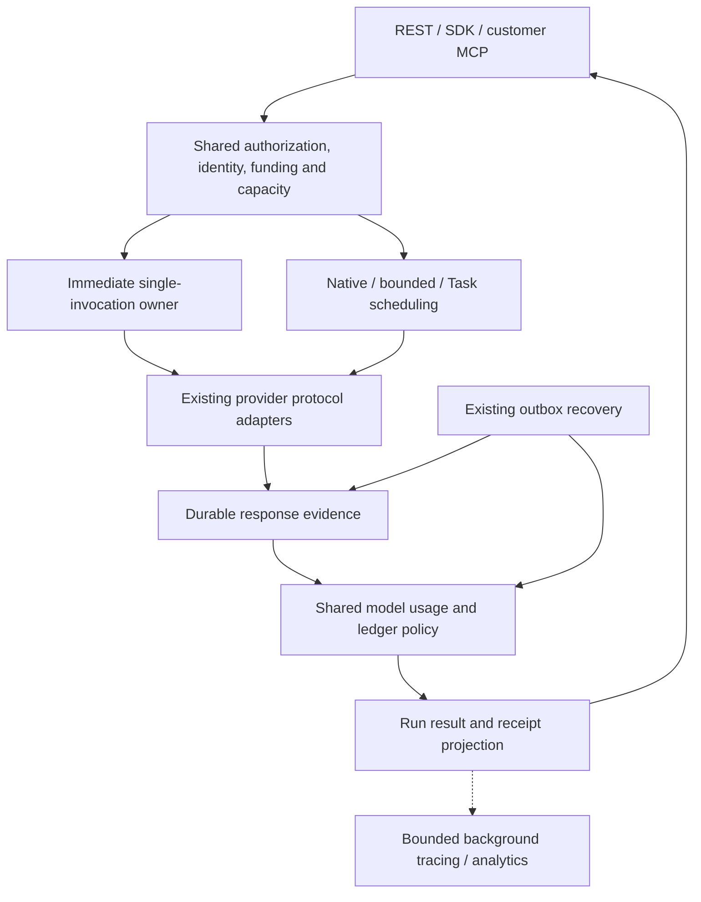

# Immediate inference: technical design and TODO

Status: implementation is present; final aggregate verification, workload calibration and release acceptance remain open. [Feature specification](immediate-inference-feature-spec.md) owns observable behavior. [Central TODO](../maintainers/TODO.md#direct-inference-latency-follow-up) owns project status; this document supplies implementation requirements and exit criteria. Current behavior belongs in the [decision implementation](../features/decisions/implementation.md), [streaming ownership](../features/api/streaming-implementation.md), [scheduling](../features/execution/scheduling.md), [billing](../features/billing/implementation.md) and [tracing](../features/observability/implementation.md). Hosted acceptance and workload calibration must be reported separately from source completion.

## Review decisions

The table below preserves the original design and its verification history. The approved [execution-efficiency design](execution-efficiency-tech-design.md) supersedes its A/B/C sequence with two normal commits (A/F), exceptional evidence capture and best-effort immediate input history. Current behavior is in the [implementation guide](../features/decisions/implementation.md#durable-request-boundary); earlier three-commit descriptions below are historical.

The implementation follows these accepted ownership and recovery decisions:

| Earlier idea                                                     | Revised decision and reason                                                                                                                                                                                                                                                                                                                                                     |
| ---------------------------------------------------------------- | ------------------------------------------------------------------------------------------------------------------------------------------------------------------------------------------------------------------------------------------------------------------------------------------------------------------------------------------------------------------------------- |
| One admission commit and one combined response/settlement commit | Preserve **three short durable boundaries**: admission/dispatch intent, response evidence, final settlement/result. Combining the last two loses the response if the process dies or the transaction aborts during settlement. A savepoint helps recover a statement failure, not a connection/process failure. Remove round trips within each owner before weakening recovery. |
| Require exactly two database commands                            | A latency target is not a SQL-function quota. Keep typed domain orchestration in TypeScript, use transaction-aware helpers and focused set-based queries. Add a narrow SQL routine only if a measured round-trip bottleneck justifies it; never copy the whole authorization/billing engine into PL/pgSQL.                                                                      |
| Synchronous special path plus optional queued passthrough        | Single-call inference always executes immediately. Queueing belongs to native/bounded execution and Tasks. Keep recovery, not ordinary queueing, behind exceptional 202 receipts.                                                                                                                                                                                               |
| Add durable trace-export references                              | Reuse the bounded background trace exporter. Durable recovery/accounting already exists; reliable trace delivery is a separate feature, not a dependency of this latency project.                                                                                                                                                                                               |
| Higher async concurrency implies huge scale                      | Measure CPU, sockets, buffering, SQL throughput, locks, fairness, provider quotas and completions across replicas. Nonblocking HTTP alone does not establish throughput.                                                                                                                                                                                                        |
| Preserve the exact queued head check for immediate calls         | Separate immediate capacity admission from queued turn ordering. Otherwise an unstarted queue head can reject a call despite idle capacity and reintroduce poller dependence. Preserve weighted ordering for queued work; select shared capacity without per-mode reservations for this version, with the overload tradeoff documented below.                                   |

The original three-commit design below is superseded by A/F; it used three commits, not three expensive worker handoffs. They happen consecutively in one request owner around the actual provider I/O. Do not claim the absolute physical optimum; preserve the product's durability while removing demonstrated unnecessary work.

## Profiling and reducing request overhead

The current optimization target is less than 100 ms of Macrofold overhead for a
single near-full-context Jev request, measured separately from the provider
round trip. This is a target, not a hosted SLA. The previous live local sample
averaged 1,232 ms overhead and included admission/control failures on a heavily
loaded host; it cannot establish healthy deployment performance.

1. Profile the actual SDK → HTTP → executor path with disposable PostgreSQL,
   a fixed synthetic provider, and the same approximately 1.5 MB context.
   Record CPU/event-loop delay, request stages, SQL count/duration/returned
   bytes, pool waits, and latency distributions. Keep provider simulation and
   live timing evidence explicitly separate.
2. Remove measured duplicate work, especially repeated returns of immutable
   context and sealed request bodies. Reuse only the confirmed owner's immutable
   input; read current generation, cancellation, retention, authority and money
   from SQL. Keep recovery able to load the complete persisted evidence.
3. Reduce unnecessary round trips within existing owners. Preserve the three
   A/B/C commits, financial journals, revocation ordering, storage/capacity locks,
   and no-redispatch recovery. Do not meet the target by deferring settlement or
   caching mutable authority.
4. Repeat matched profiles, run affected existing failure/accounting/replay
   checks and bounded concurrent fixtures, then update the implementation and
   verification owners with measured results and any remaining bottleneck.

Profiling must not record input, SQL arguments, credentials or customer output.
Leave the shared preview, workers and developer environment unchanged.

## Current flow and concrete sources

| Owner                                                                                                                                                                | Implemented responsibility                                                                                                                                                                    |
| -------------------------------------------------------------------------------------------------------------------------------------------------------------------- | --------------------------------------------------------------------------------------------------------------------------------------------------------------------------------------------- |
| [http.ts](../../packages/core/src/http.ts)                                                                                                                           | Shared authentication/rates/validation, same-key replay, bounded preparation/admission, immediate completion or recovery projection, retained producer lifetime; async preference is rejected |
| [api-handlers.ts](../../packages/core/src/api-handlers.ts)                                                                                                           | Always selects immediate admission for `createInference`; native/bounded operations retain queued admission                                                                                   |
| [inferences.ts](../../packages/core/src/inferences.ts)                                                                                                               | Prepares context/catalog outside admission locks; atomically freezes authority/funding/capacity, Run identity and dispatch intent, then returns the original owner permit                     |
| [direct-inference.ts](../../packages/core/src/direct-inference.ts)                                                                                                   | Coordinates A → provider → B → C, typed terminal/recovery receipts and bounded evidence-only recovery                                                                                         |
| [inference-engine.ts](../../packages/core/src/inference-engine.ts)                                                                                                   | Owns queued bounded phases and delegates direct recovery to the immediate coordinator; shared invocation helpers live in `inference-invocations.ts`                                           |
| [model-gateway.ts](../../packages/core/src/model-gateway.ts)                                                                                                         | Shared transaction-aware usage/settlement with a wrapper for native callers; native protocol forwarding remains separate                                                                      |
| [engine.ts](../../packages/core/src/engine.ts), [scheduling.ts](../../packages/core/src/scheduling.ts)                                                               | Share account/fleet admission through `execution-admission.ts`; queued owners alone retain ordering and native placement                                                                      |
| [portable-dispatch.ts](../../packages/core/src/portable-dispatch.ts), [local-dispatch.ts](../../packages/core/src/local-dispatch.ts)                                 | Durable queued work and recovery; direct healthy requests should not use their claim loop                                                                                                     |
| [direct-inference-stream.ts](../../packages/core/src/direct-inference-stream.ts)                                                                                     | Transient output delivery, retained producer lifetime, bounded reader queue and replay                                                                                                        |
| [REST host](../../apps/web/app/v1/[[...path]]/route.ts), [MCP host](../../apps/web/app/mcp/route.ts), [customer MCP bridge](../../packages/core/src/customer-mcp.ts) | Both hosts pass retained background work and the verified host deadline. Healthy inference/replay avoids dispatch nudges; queued mutations and exceptional recovery retain them.              |
| [decision-protocols.ts](../../packages/providers/src/decision-protocols.ts), [inference-stream.ts](../../packages/providers/src/inference-stream.ts)                 | Vendor preparation, HTTP, complete response assembly and usage normalization                                                                                                                  |
| [database wrapper](../../packages/db/index.ts)                                                                                                                       | Tenant transactions, cumulative acquisition/SQL budgets, explicit unknown-commit classification and after-commit callbacks                                                                    |

External callers that previously selected async, polled and separately fetched usage must adopt the immediate receipt contract. The public [coding-agent integration brief](../features/decisions/README.md#build-this-with-your-coding-agent) provides the handoff. No external checkout was changed or qualified by this implementation; record its revision during separately authorized caller acceptance.

The observed claim delays are evidence of the affected boundary, not proof of whether pool starvation, locks, query execution or the environment caused them. Instrument these separately. Avoid unproven JIT/configuration changes or unrelated query rewrites.

## One system, different execution owners



This is logical ownership inside the existing modular application. Do not create another service or public inference API. Native harnesses retain their protocol gateway and runtime; the diagram does not move native tool execution onto the API host.

### Refactor map

| Change                                      | Location and interface                                                                                                                                                                     | Other callers and safeguards                                                                                                                                                                                                |
| ------------------------------------------- | ------------------------------------------------------------------------------------------------------------------------------------------------------------------------------------------ | --------------------------------------------------------------------------------------------------------------------------------------------------------------------------------------------------------------------------- |
| Compose one immediate execution             | Keep `direct-inference.ts` as coordinator; accept prepared invocation data and return typed completed/recovering results instead of an `unknown` envelope plus fixed three-advance loop    | JSON and SSE share the coordinator; no duplicate provider call or accounting branch                                                                                                                                         |
| Extract invocation lifecycle                | Add a focused `inference-invocations.ts` only for preparation, dispatch-intent CAS, response evidence, validation and persisted recovery state currently embedded in `inference-engine.ts` | Immediate and bounded owners call the same functions; bounded context/tool turns remain in `bounded-decisions.ts`                                                                                                           |
| Make model settlement composable            | Extract `settleModelRequestInTransaction(tx, ...)` from `model-gateway.ts`, with the existing transaction-opening wrapper delegating to it                                                 | Native gateway keeps its current wrapper; direct finalization composes the same mutation with Run completion; native model completion must not finish its parent agent Run                                                  |
| Separate capacity from queued orchestration | Extract current capacity predicates and claim mutations from `claimRunInTransaction` into a focused domain owner, e.g. `execution-admission.ts`                                            | All owners share caps/locks; queued owners additionally apply turn ordering and native placement. Immediate owners do not call `schedulerTurn`. The selected target policy is explicit below.                               |
| Reuse identity and idempotency              | Small shared helpers in the existing HTTP/domain boundary, no second auth or mutation framework                                                                                            | Leave unrelated file/object preparation and admin routes unchanged; only skip preflight work when the direct request has no external preparation                                                                            |
| Present complete receipts                   | One typed projection used by direct completion, saved Run result and stream terminal events                                                                                                | SDKs, MCP, CLI, dashboard and billing use the same definitions; do not calculate money in a presenter                                                                                                                       |
| Observe active requests together            | A bounded process-local cancellation observer for owned in-flight inference invocations                                                                                                    | Poll current authority/cancel/deadline in batches using restricted, content-free access; no process-local state becomes durable execution authority                                                                         |
| Compose host lifecycle hooks                | REST and customer MCP pass the existing retained-background capability through to HTTP orchestration; distinguish producer retention/diagnostics from queue dispatch nudges                | Do not wake `dispatchRuns` after a healthy immediate completion/replay. Preserve nudges for queued mutations and exceptional recovery using shared operation/effect knowledge, not duplicated URL tests or a new event bus. |

Keep `DecisionProtocol` and `ModelProtocol` distinct where they have different wire behavior. Share credentials, pricing arithmetic, usage models, failure policy and settlement through their existing owners; do not force native gateway streams and normalized decisions into a generic transport rewrite.

Use concrete exported types. Suggested domain interfaces below are contracts to implement, not new public DTOs:

```ts
// Reuse the repository's actual domain types; names below show the intended split.
type Admission =
  | { kind: 'dispatch'; permit: InvocationPermit }
  | { kind: 'replay'; receipt: ExistingInvocationReceipt };

// Runs inside the caller's tenant transaction; never opens another transaction.
admitImmediateInference(tx, principal, prepared, requestIdentity): Promise<Admission>;
persistInferenceResponse(tx, permit, responseEvidence): Promise<ResponseReference>;
settleModelRequestInTransaction(tx, settlement): Promise<ModelBillingReceipt>;
finalizeInference(tx, responseReference, validatedResult): Promise<CompletedInferenceReceipt>;

// Pure bounded work, outside SQL; binds its result to the saved evidence identity.
validateInferenceResult(responseEvidence, frozenConfiguration): ValidatedInferenceResult;

// Provider I/O is outside SQL; only the durable dispatch owner may call this.
executeInferenceInvocation(permit, signal, outputSink?): Promise<ProviderEvidence>;
```

`InvocationPermit` binds organization/Run/invocation IDs, ownership generation, immutable prepared request, frozen terms, exact credential binding and deadline. Credentials are ephemeral secrets, never serialized in a permit/receipt/log. A permit is internal, not client-supplied authority. Keep one completion projection, typed uncertainty states, and no `any`/double-cast escape hatches.

## Healthy request sequence

### Preparation without external side effects

Authenticate sufficiently to protect tenant/context reads, validate the request, resolve immutable definitions/context and prepare the exact provider body once. Reuse compiled validators. Catalog refresh and object reads remain outside lock-holding transactions. Fresh inline scoring requests need neither. Cache only immutable definitions/schema compilation and valid catalog metadata; never cache a stale spending permission, revoked key, decrypted customer credential or mutable context across requests.

Avoid repeated JSON canonicalization, schema compilation, payload construction and encryption of identical bytes. Keep provider-native payload semantics and protocol-owned routing/price ceilings. Context object I/O is legitimate additional work and must be measured separately.

### Transaction A: admit and commit dispatch intent

1. Take the existing idempotency lock and resolve a stored identity before creating new work. A replay must not redo expensive preparation unnecessarily; retain preflight lookup for object-backed preparation when it avoids real I/O.
2. Acquire shared admission/account locks in the order established by the existing owners. Perform current principal, organization, scope, workspace, context grant/expiry, exact BYOK, billing-hold and model checks after potentially blocking acquisition. Acquire the global capacity lock only for the final capacity decision/mutation. External credential refresh, context I/O and provider preparation happen before all admission locks; revalidate their binding/revision inside A. Recheck time-based expiry/deadline after waits. Reuse existing revocation locking/version guards; a transaction alone does not prevent a stale authorization read.
3. Freeze rates and reserve liability in that same transaction using the established financial lock order; check/mutate current account/fleet capacity under the global lock. This is one atomic commit, not permission to move financial lock acquisition after the global lock if existing owners acquire it first. Do not require a queued scheduler winner for immediate admission. Roll back rejected rows/holds on 429. Enumerate and exercise the shared lock order before changing it.
4. Create the Run, immutable configuration, gateway request, invocation, accepted event and idempotency identity together. Commit the invocation directly as `dispatch_started` for immediate execution. Keep `prepared` for queued/bounded steps where there is a genuine gap before authorization/dispatch.
5. Persist the existing recovery job, fenced through the bounded owner-completion window described below. It is recovery ownership, not a normal dispatch hop. Retain actual lease generation and compare-and-set guards.
6. Return the in-memory dispatch permit after commit; release the DB connection. Start provider I/O immediately with no intervening scheduler claim, catalog refresh or trace lookup.

Combining immediate preparation and dispatch intent sacrifices proof that a crash just after admission happened before HTTP dispatch: recovery must conservatively classify the committed intent as uncertain. This is deliberate; never replay it automatically. Only the original owner receiving a confirmed successful A commit may initiate the provider request. If commit acknowledgment is lost, read the saved identity to return its status; finding `dispatch_started` is not permission for that retry or recovery reader to invoke the provider.

### Provider I/O

Use the existing adapter and pooled HTTP transport, with the exact frozen request, credential and deadline. Disable automatic paid retries/fallbacks where they are not already disabled. Keep redirects and request/response limits enforced. No database client, tenant lock or global lock survives into this section.

Forward supported deltas immediately while assembling one bounded response. Ordinary scoring waits for its complete native result. Distinguish provider rejection, incomplete response, malformed usage and transport uncertainty using the protocol's evidence; an HTTP/network exception alone is not proof that no charge occurred.

Retain the existing disconnect semantics: delivery detaches, execution remains owned by the supported host lifetime and deadline. Register the **same producer promise** for JSON and SSE with the host lifetime before starting admitted work; awaiting it for JSON must not be its only lifetime protection. Do not start a second producer in the background hook. Explicit cancellation/authority revocation requests best-effort abort. A request handler cannot guarantee continuation after hard process death; durable recovery must handle it without dispatching again.

### Clock and ownership rules

Use one typed internal budget policy in the immediate coordinator, supplied by application composition. Host adapters supply their verified absolute lifetime deadline; do not expose these infrastructure margins as customer Run limits or add an environment variable for every constant. The following are implemented initial defaults, not measured capacity claims. Required I0 calibration remains incomplete; freeze release values only after that acceptance, without treating source completion as proof. Changing one requires updating this table and its deadline/failure fixtures.

| Budget                            | Initial value / calculation                                                                                  | Owner and expiry                                                                                                                                                                                                                                  |
| --------------------------------- | ------------------------------------------------------------------------------------------------------------ | ------------------------------------------------------------------------------------------------------------------------------------------------------------------------------------------------------------------------------------------------- |
| Host lifetime `H`                 | Absolute deadline measured conservatively from host invocation entry; currently 300 seconds in the REST host | REST/MCP composition supplies the actual deployment limit. A standalone host supplies a finite verified limit too. Streaming and background retention do not extend it.                                                                           |
| Admission `A`                     | 1,000 ms cumulative from first admission permit/pool acquisition through transaction A commit                | `direct-inference.ts` passes the remaining budget into pool, idempotency, financial and capacity lock waits and SQL. Exhaustion before confirmed admission rolls back and returns 503 `inference_admission_timeout`; no internal admission retry. |
| Requested execution `W`           | Existing caller timeout, at most 240 seconds                                                                 | The shared admission owner records one accepted start timestamp after waits in A and its execution deadline `E = accepted_start + W`. Provider dispatch uses that deadline; no reset at HTTP connect, first token or recovery.                    |
| Completion allowance `C`          | 30,000 ms                                                                                                    | Preserving evidence, validating and finalizing share this allowance. It is time to finish bookkeeping, not additional provider execution time.                                                                                                    |
| Delivery margin `G`               | 5,000 ms                                                                                                     | Reserve for receipt serialization/response delivery and orderly handoff before `H`; it is not a guarantee against an arbitrarily slow client.                                                                                                     |
| One evidence/finalization attempt | At most 10,000 ms, further capped by remaining completion time; at most three attempts combined per boundary | Only retry a known rollback/transient persistence failure with the same evidence identity. An unknown commit acknowledgment requires identity readback before another mutation. No retries of provider I/O.                                       |

For a new dispatch, preparation, including catalog/context I/O, must finish while `H - now >= A + W + C + G`. Abort preparation when that latest start time is reached. Immediately before A commits, recheck `E + C + G <= H` after all potentially blocking acquisition; otherwise roll back with 503 `inference_host_budget_exhausted`. Do not silently shorten the caller's execution window. A host that cannot fit a valid requested window must fail before admission; a larger supported window needs coordinated host/SDK changes. Existing-identity replay needs only its bounded read/response budget, not another full `W + C` window or a new execution permit.

All waits consume their enclosing cumulative budget, including pool checkout and transaction setup. Set transaction-local lock/statement deadlines from the remaining budget through the existing database wrapper; do not change global database timeouts or let each query restart a full timeout. B/C have priority over new admission through bounded admission concurrency in the shared pool. A commit whose acknowledgment times out is **not** known to have rolled back: resolve its identity and apply the recovery response contract instead of claiming a safe pre-admission failure.

The provider timer aborts at `E`. When a complete response arrives, the trusted owner captures completion time before normalization; B persists that fact with the same generation/evidence identity in a nullable `decision_invocations.provider_completed_at` column. Only a complete bounded transport response sets it; partial/oversized/interrupted responses leave it null. It records receipt time, not B's later commit time. Use monotonic elapsed time for in-process comparisons, anchored to the accepted durable clock for recovery; never trust a provider/client timestamp as proof of timeliness or a cross-host clock subtraction. Local completion may run until `min(response_or_failure_observed_at + C, E + C, H - G)`. If it cannot finish, return the appropriate 202 recovery receipt and retain only the existing bounded host-owned producer; do not extend HTTP lifetime or start another provider call.

**A timely provider result is not timed out merely because Macrofold's settlement is slow.** B/C and timeout recovery inspect the recorded completion fact. A complete response received by `E` may finalize successfully after `E`; until then it is `finalization_pending`. If the provider did not finish by `E`, timeout wins and partial/late evidence is accounted for without a successful value. Cancellation, current authority denial, purge and an already committed terminal state still fence publication. This exception is limited to immediate inference; do not change native/bounded execution deadlines.

Persist the existing recovery job's fence as `E + C`, not a fixed five seconds after provider timeout. Timeout maintenance must honor this owner-completion fence for direct invocations before deciding that timely response evidence is absent. Once B commits and the original owner explicitly hands off failed C, make finalization recovery due immediately using the existing generation/CAS mechanism; the former owner must stop mutations. Recovery only consumes saved evidence or classifies ambiguity. It never dispatches again. A response still missing after the fence yields an uncertain failure, or timeout if the deadline caused interruption, preserving provisional accounting. Later evidence cannot revive that terminal outcome.

Graceful shutdown stops new admissions and drains existing producers only within their recorded completion fences and the host shutdown allowance. Hard shutdown uses durable recovery. No new per-call heartbeat or indefinite lease renewal is needed.

### Transaction B: preserve provider evidence

Seal and store the complete response or available incomplete evidence, normalized usage, provider request identity and provider timing. Seal bounded immutable bytes before acquiring SQL locks; transaction B checks ownership and retention before publishing them. Use the Run-first locking/fencing convention shared with cancellation and retention. A content purge wins; do not resurrect erased content. Record only accounting facts still permitted after purge.

Commit before validation/settlement code that can fail. The response remains recoverable even if later validation, ledger work or process execution fails. Publish any bounded-agent final event batch under its existing atomic evidence contract; direct deltas still do not become durable per-token events.

Distinguish transport evidence from successful normalization. Today `DecisionProtocol.invoke` can capture a raw response and then throw during schema/usage parsing; its diagnostic callback is not durable evidence. Extend that existing port with a typed failure/evidence result sufficient to preserve bounded available response data, HTTP/request identity and independently validated usage when decoding fails. Never invent complete usage from malformed fields. Keep this encrypted under existing content retention, never in ordinary logs; do not add a raw-response table or duplicate successful native payloads already retained as the result. Update the port's current diagnostics-only comment and its callers. Missing/oversized/malformed bodies retain only bounded evidence and explicit uncertainty, never an unbounded download or a paid retry.

After B, perform pure typed-output validation and receipt-data preparation outside SQL using the immutable response/configuration. Bind the prepared result to the saved invocation/evidence revision. Recovery uses the same pure function on saved evidence. A typed-output validation failure is a recorded outcome, not a reason to erase the provider response or skip accounting.

### Transaction C: finalize once

Re-read only current authority/lifecycle fields needed for cancellation, retention, deadline and ownership, and confirm the prepared result matches the saved evidence. Native output does not acquire an invented JSON-only contract. No schema compilation, provider decoding, external I/O or whole-response encryption runs while these locks are held.

Call the transaction-aware shared model settlement, then finalize Run state, settle the existing Run reservation, mark its recovery job done, publish required terminal events, and persist the completed receipt. They commit atomically. Return the receipt from this transaction; do not reload the full Run or query the billing report to produce the HTTP response.

Move the current `finish` logic into a transaction-aware helper. It must use the updated Run cost after model settlement, not a stale pre-settlement object. Repeated finalization returns the same recorded result without repeating charges or releasing capacity twice. A cancelled/timed-out Run still accounts for its accepted provider request; current terminal state must never be resurrected.

After commit and connection release, schedule existing trace/request-summary exports through the host lifecycle. Exporter failure does not affect result success. No new trace table/outbox is required.

## Response and client contract

### Upstream rejection messages

The direct inference follow-up adds optional `InferenceReceipt.provider_error`
alongside the existing classified `reason_code`. It contains the upstream
`http_status`, textual `message`, optional scalar `code` normalized to a string,
and `truncated: true` only when the 16 KiB message bound is reached. Preserve
provider wording except credential redaction; forward no headers, stack or raw
response envelope. Explicit SSE error messages use the same contract and preserve
the actual HTTP status even when it is 200. Successful malformed model output is
not an upstream error message.

Implementation owners and completion criteria:

1. The shared provider parser extracts recognized JSON/plain-text rejections and
   explicit SSE errors. Direct and custom deployment protocols reuse it, retain
   usage independently and never retry an inference. Redact the selected secret,
   credential-bearing configured headers and recognizable credential strings.
2. Core carries the diagnostic through encrypted invocation evidence and shared
   receipt construction. Keep exact messages out of unencrypted Run metadata,
   logs and lifecycle events. Reuse batched encrypted result hydration for GET,
   replay and recovery; the live successful path gains no query. Revocation and
   purge suppress this content just as they suppress output values.
3. Update OpenAPI, all generated clients, public JSON/SSE examples and internal
   ownership documentation. Preserve terminal HTTP/status/retry/accounting
   contracts and distinguish provider rejection from uncertain execution.
4. Verify exact messages, secret exclusion, malformed/oversized errors, streaming
   usage, replay, revocation/purge, transport and all SDKs with disposable fixtures.
   Native agent startup is a separate queued path; its phase timings do not
   establish direct inference latency or a tens-of-milliseconds cold harness SLA.

Implemented and verified locally: shared extraction, encrypted receipt ownership,
all five SDKs and JSON/SSE API fixtures pass. See the [verification record](../features/decisions/verification.md#upstream-rejection-messages).

### Shared receipt fields

Keep `InferenceResponse`, `RunResult` and `InferenceReceipt` as the public ownership chain. Extend `InferenceReceipt` with reusable OpenAPI components for invocation usage and billing; persist them in the same saved result. Do not return the organization wallet, another Run's costs, credential IDs beyond existing authorized fields, or unrestricted report data.

| Field under `result.inference` | Definition                                                                                                                                                                                                                                                                                                                                        |
| ------------------------------ | ------------------------------------------------------------------------------------------------------------------------------------------------------------------------------------------------------------------------------------------------------------------------------------------------------------------------------------------------- |
| `usage`                        | Required object on new non-purged terminal inference receipts: `input_tokens`, `output_tokens`, `cached_input_tokens`, `cache_write_input_tokens` are required nonnegative integer decimal strings or null; `completeness` is `complete` or `missing`. Cache reads/writes are subsets of total input; do not add them again. Missing is not zero. |
| `billing`                      | Required object on those receipts, projecting the invocation's settled accounting using the exact fields below; never calculate charges in response presentation                                                                                                                                                                                  |
| `timings_ms`                   | Existing timing object, with documented stage names; absent measurements remain absent                                                                                                                                                                                                                                                            |

Reuse existing exact money and cost-field schemas. Provider-reported account cost, upstream inference cost and estimated provider cost overlap; never sum them. Langfuse native cost continues to be the Macrofold customer charge. BYOK model charge is zero even when its actual provider account cost is positive. Streaming and non-streaming use identical accounting.

Define reusable `InferenceUsage` and `InferenceBilling` OpenAPI components; compose existing token/money/provider-cost field definitions from `BillingModelUsage`. All billing fields below are present; unknown numeric values are null. `provisional` and `bound_breached` are required booleans, not nullable.

| Billing field                   | Wire type and meaning                                                                                                                                          |
| ------------------------------- | -------------------------------------------------------------------------------------------------------------------------------------------------------------- |
| `billing_mode`                  | `managed` or `byok`, frozen on the invocation                                                                                                                  |
| `charged_micro_usd`             | Nonnegative integer decimal string or null; Macrofold customer model charge; `"0"` for BYOK                                                                    |
| `budget_cost_micro_usd`         | Same money type; amount consumed from the caller's model budget                                                                                                |
| `reserved_micro_usd`            | Same money type; original invocation liability ceiling, **not** remaining held funds. The existing envelope-level field continues to mean remaining Run funds. |
| `reported_micro_usd`            | Same money type; existing retail-rated usage amount, **not** provider-reported account cost                                                                    |
| `provisional`, `bound_breached` | Shared settlement facts; missing usage can be provisionally settled at the admitted bound                                                                      |
| `provider_cost_micro_usd`       | Same money type; frozen-rate provider-cost estimate                                                                                                            |
| `provider_cost_status`          | `estimated_from_usage` or `unavailable`                                                                                                                        |
| `provider_reported_cost_usd`    | Finite nonnegative JSON number or null, preserving the existing USD/sub-micro precision contract                                                               |
| `provider_reported_cost_status` | `reported` or `unavailable`                                                                                                                                    |
| `upstream_inference_cost_usd`   | Finite nonnegative JSON number or null; separate provider diagnostic, not an additional charge                                                                 |

Use `complete` only when the shared usage normalizer establishes all billable counts. Preserve independently known counts with `missing` for incomplete evidence. Zero counts for a proven uninvoked request are facts; missing counts after uncertain dispatch are not. The status fields must agree with nullability. Do not expose wallet balances or unrelated usage records to fill these fields.

Expose invocation-specific billing to the authorized submitter/result reader under existing Run permissions, without granting organization-wide billing scope. Replays and result GETs still enforce current tenant/resource authority. Keep the existing response scope behavior unless a separate security change is required; streaming still needs `runs:read`.

On this endpoint remove `Prefer: respond-async`, its `Preference-Applied` handling, and `queue_timeout_seconds` from the public request shape. Reject the known async header early even after removing its OpenAPI enum; headers otherwise may not be validated as body properties are. Remove the async preference from execution fingerprints; no compatibility alias is required. Preserve the current `stream` fingerprint behavior: changing stream/body is a different execution request and conflicts. A malformed/unsupported header never creates a second Run for a previously used key.

### Terminal and recovery envelopes

For this operation, make `InferenceResponse` an explicit terminal/recovery union. Preserve its required `run_id`, `session_id`, `worktree_id`, `status` and `urls`; inline inference keeps both nullable IDs null. Always include all five receipt URLs: status `/v1/runs/{id}`, result `/v1/runs/{id}/result`, events `/v1/runs/{id}/events`, stream `/v1/runs/{id}/stream`, and cancel `/v1/runs/{id}/cancel` (POST). Return absolute URLs using the configured public API origin, not an untrusted Host header. Shared Run statuses and URLs remain unchanged.

| Variant                       | Required behavior                                                                                                                                                                                                                                                                                                                                                                        |
| ----------------------------- | ---------------------------------------------------------------------------------------------------------------------------------------------------------------------------------------------------------------------------------------------------------------------------------------------------------------------------------------------------------------------------------------- |
| HTTP 200 terminal             | `status` is `succeeded`, `failed`, `cancelled` or `timed_out`; `result.final` is true, `result.run_id` matches the envelope, `persistence_status` is `not_required`, and `execution_outcome` is respectively `success`, `failure`, `cancelled` or `timed_out`. New non-purged immediate results include `result.inference`, including no-value failure receipts. Omit `recovery_reason`. |
| HTTP 202 accepted, incomplete | `status` is `running`; omit `result`; require top-level `recovery_reason` from the table below. This describes the existing admitted invocation, not acceptance into a queue. Include `Retry-After: 1` as a retrieval hint, not a completion ETA.                                                                                                                                        |
| Purged history                | Preserve current retention: authorized result GET can return `final:true` plus `content_expired:true`/`content_expired_at` without `inference`. Same-key POST replay returns 410 `content_expired`, preserving the fingerprint. Do not reconstruct purged content or make `inference` globally required on every RunResult.                                                              |

| `recovery_reason`      | Durable evidence and next action                                                                                                                                                                                                                                         |
| ---------------------- | ------------------------------------------------------------------------------------------------------------------------------------------------------------------------------------------------------------------------------------------------------------------------ |
| `in_progress`          | The admitted ownership window is still active with no recorded completion; execution may still be running. A fence is not proof that its process survived. Retrieve the same Run or explicitly cancel it; duplicates return promptly without joining an HTTP wait queue. |
| `finalization_pending` | B committed; local accounting/result publication remains. Retrieve the same Run; recovery can finish without another provider call.                                                                                                                                      |
| `outcome_unknown`      | Dispatch may have happened but no complete durable response is known and recovery is unfinished. Retrieve the same Run; never create a replacement automatically. Once recovery commits a terminal uncertain result, use HTTP 200 instead of this reason.                |

Terminal inference outcome mapping is fixed: `succeeded` permits `value`, `unknown`, `refused` and `stale_input`; `failed` permits `invalid_output`, `failed` and `uncertain`. Cancelled/timed-out receipts use `failed` or `uncertain` according to evidence and carry the shared terminal `reason_code`, with no `value`. Successful `value` alone carries usable output; `unknown`, refusal and stale input are explicit non-actionable decision outcomes. `provider_outcome` remains `not_invoked`, `responded` or `uncertain`; it is independent of validation/publication success. Preserve native provider output inside `value` without imposing a new JSON answer schema.

The following are normative **response projections** for documentation and fixture assertions, not complete schema fixtures; existing required digests, invocation/model/validation fields and URLs still come from the shared components. During I4, materialize full examples from these components and validate them against OpenAPI rather than maintaining divergent hand-written receipts.

```json
{
  "status": "succeeded",
  "result": {
    "final": true,
    "execution_outcome": "success",
    "persistence_status": "not_required",
    "inference": {
      "outcome": "value",
      "provider_outcome": "responded",
      "value": {
        "answer": "yes"
      },
      "usage": {
        "input_tokens": "100",
        "output_tokens": "2",
        "cached_input_tokens": "0",
        "cache_write_input_tokens": "0",
        "completeness": "complete"
      },
      "billing": {
        "billing_mode": "byok",
        "charged_micro_usd": "0",
        "budget_cost_micro_usd": "5",
        "reserved_micro_usd": "1000",
        "reported_micro_usd": "5",
        "provisional": false,
        "bound_breached": false,
        "provider_cost_micro_usd": "5",
        "provider_cost_status": "estimated_from_usage",
        "provider_reported_cost_usd": 4.2e-6,
        "provider_reported_cost_status": "reported",
        "upstream_inference_cost_usd": null
      }
    }
  }
}
```

```json
{
  "status": "failed",
  "result": {
    "final": true,
    "execution_outcome": "failure",
    "persistence_status": "not_required",
    "inference": {
      "outcome": "uncertain",
      "provider_outcome": "uncertain",
      "usage": {
        "input_tokens": null,
        "output_tokens": null,
        "cached_input_tokens": null,
        "cache_write_input_tokens": null,
        "completeness": "missing"
      }
    }
  }
}
```

```json
[
  {
    "status": "running",
    "recovery_reason": "in_progress"
  },
  {
    "status": "running",
    "recovery_reason": "finalization_pending"
  },
  {
    "status": "running",
    "recovery_reason": "outcome_unknown"
  }
]
```

The failed projection also requires the normal billing object, including `provisional:true` when liability is settled provisionally. Cancellation/timeout use the same no-value form with their corresponding status/execution outcome. A late observation does not silently rewrite a previously returned provisional receipt; retain the existing reconciliation policy. `GET /v1/runs/{id}/result` keeps HTTP 200 with `final:false` while pending, or `final:true` after completion; do not make that generic endpoint use POST's 202 semantics.

### HTTP refusal and recovery matrix

Use the existing `Error`/`ErrorDetail` envelope. For inference errors, type its bounded `details` as an inference-specific component: `idempotency_key` when supplied, `run_id` and authorized receipt `urls` when known, and optional `reason`. Echo only validated submitted identity; it is not authorization. SDK-generated identity remains available even when no response exists. Keep unrelated error contracts intact.

| Condition                                                                    | HTTP / stable code                                                                                                                                                                            | `retryable` / `Retry-After`              | Durable Run? / caller action                                                                                                                                  |
| ---------------------------------------------------------------------------- | --------------------------------------------------------------------------------------------------------------------------------------------------------------------------------------------- | ---------------------------------------- | ------------------------------------------------------------------------------------------------------------------------------------------------------------- |
| Requested queued delivery                                                    | 400 `async_inference_not_supported`                                                                                                                                                           | false / absent                           | No new Run; remove async preference before first valid submission                                                                                             |
| Unsupported stream or duration                                               | Existing 400 `streaming_not_supported`, `streaming_timeout_unsupported` or `direct_timeout_exceeded`                                                                                          | false / absent                           | No new Run; correct request/capability                                                                                                                        |
| Invalid input, missing authorization, denied policy/funding                  | Existing 4xx codes                                                                                                                                                                            | Preserve existing policy, no blind retry | No new Run; correct the indicated condition                                                                                                                   |
| Administrative execution disablement                                         | Existing 503 `inference_disabled` or `execution_disabled`                                                                                                                                     | false / absent                           | No new Run; requires operator/configuration correction, not a retry loop                                                                                      |
| Key HTTP rate                                                                | 429 `rate_limited`                                                                                                                                                                            | true / seconds until rate-window reset   | No new Run; retry the same request/key after the hint within caller deadline                                                                                  |
| Account/fleet capacity                                                       | 429 `inference_capacity_unavailable` or existing streaming equivalent `streaming_capacity_unavailable`; `details.reason` = `account_concurrency`, `lightweight_capacity` or `global_capacity` | true / 1 second                          | No new Run; same-key retry is safe after rollback                                                                                                             |
| Local in-flight/observer capacity or dependency unavailable before admission | 503 `inference_service_unavailable`; reason = `local_capacity`, `observer_capacity` or `dependency_unavailable`                                                                               | true / 1 second                          | No new Run; same-key retry is safe                                                                                                                            |
| Cumulative admission budget exhausted with confirmed rollback                | 503 `inference_admission_timeout`                                                                                                                                                             | true / 1 second                          | No new Run; same-key retry is safe                                                                                                                            |
| Requested execution window cannot fit remaining verified host lifetime       | 503 `inference_host_budget_exhausted`                                                                                                                                                         | true / 1 second                          | No new Run; retry on a healthy compatible host; no automatic shortening of limits                                                                             |
| Commit acknowledgment lost and identity readback also unavailable            | 503 `inference_admission_unknown`                                                                                                                                                             | false / absent                           | Run may exist; preserve the key and resolve with identical same-key submission once service recovers. Never dispatch from a found intent or claim no charges. |
| Different execution request under the same key                               | 409 `idempotency_conflict`                                                                                                                                                                    | false / absent                           | Original identity unchanged; do not retry to recover by changing its payload                                                                                  |
| Active same-key stream                                                       | 409 `stream_already_started`, original authorized receipt in details                                                                                                                          | false / absent                           | Existing Run; retrieve result, not another stream producer                                                                                                    |
| Active/recovering JSON replay or completion handoff                          | 202, no Error envelope                                                                                                                                                                        | Not an exception / 1 second              | Existing Run; inspect `recovery_reason` and retrieve                                                                                                          |
| Terminal success/failure/replay                                              | 200, no Error envelope                                                                                                                                                                        | Not an exception / absent                | Existing Run; inspect status/outcome and accounting                                                                                                           |
| Purged same-key replay                                                       | 410 `content_expired`                                                                                                                                                                         | false / absent                           | Identity remains consumed; output cannot be recovered                                                                                                         |

Current authorization applies before disclosing any existing Run/URLs; do not leak identity through an error after access is revoked. `retryable:false` for ambiguous admission forbids automatic transport retry, not deliberate same-key identity recovery. Override the generic all-503s-retryable behavior for these inference-specific administrative/unknown cases. The refusal/unknown categories must be documented and tested independently; a network exception or generic database error must never be classified as a confirmed rollback without evidence.

Example confirmed pre-admission refusal (HTTP 503, `Retry-After: 1`); unlike `inference_admission_unknown`, this permits an opt-in same-key retry:

```json
{
  "error": {
    "code": "inference_service_unavailable",
    "message": "Immediate inference capacity is busy. Retry with the same idempotency key.",
    "request_id": "01900000-0000-7000-8000-000000000001",
    "retryable": true,
    "details": {
      "idempotency_key": "example-call-001",
      "reason": "local_capacity"
    }
  }
}
```

### Streaming and SDK rules

Before SSE headers, use the matrix above. Keep the existing `InferenceStreamEvent` envelope and discriminated `data` components. `run.accepted.data` contains the authorized receipt plus `delivery:live|result_replay`; terminal `run.succeeded|failed|cancelled|timed_out` data contains the finalized terminal envelope and its `result`. Only C's committed outcome can produce a terminal event. A completed replay emits accepted plus that terminal event, with no reconstructed deltas.

For incomplete delivery after headers, `transport.error.data` requires `code`, safe `message`, `idempotency_key`, `urls`, and `recovery_reason` with the same three meanings above; the enclosing event carries `run_id`. Use `inference_recovery_required` when completion is pending and `stream_interrupted` when delivery fails while execution continues. If C is already committed but terminal delivery fails, use `reason:result_available` instead of a nonterminal recovery reason; consumers retrieve the saved result. Define these two variants in OpenAPI so they cannot contain contradictory fields. A dead connection may carry no final frame; EOF without a terminal event is a transport failure and the SDK still retains the locally known key. No hidden reconnect, new Run status or replay of paid execution is introduced.

For `inferences.create` and `inferences.stream`, make exactly one transport attempt by default in all five SDKs, including before response headers. Leave unrelated operation defaults unchanged. Retain the existing 300-second finite request timeout; a shorter explicit caller timeout detaches delivery without cancelling the accepted Run. Explicit opt-in retries use the original key/body and one total deadline (default maximum two retries if enabled without a lower count). Automatically retry only confirmed pre-admission refusals marked retryable; ambiguous network/decode/commit errors require identity recovery. Honor the full `Retry-After` (seconds or HTTP date), with positive jitter; if the wait plus another attempt cannot fit, return the error immediately. Do not cap a server hint downward, reset timeouts per attempt or retry after SSE starts.

All submission errors retain the caller-supplied/generated idempotency key: pre-header abort/deadline, HTTP refusal, decode failure, stream framing/EOF, and any error returned on explicit reader detachment. Attach `run_id`, URLs and request ID when known. Preserve typed cancellation/timeout classification and the original cause; do not replace these with an opaque generic error. A normal reader close remains a normal detach. HTTP 200 terminal failures and 202 recovery receipts are typed results, not submission exceptions. Resource helpers must not automatically poll, fetch billing, cancel or create a new key to recover.

Server-side maximum direct duration remains 240 seconds initially, matching current app/client lifetime margins. Change the obsolete advice to use async for longer requests. Explain the supported limit and separately available agent/task APIs without recommending those as semantically identical one-call proxies. A future longer single-call path must configure and verify API/load-balancer/SDK/provider timeouts together. Streaming does not bypass hosting duration limits.

Update all five SDKs via the generators. Maintained transports must preserve mutation identity, finite timeouts, and the distinction between HTTP rejection, terminal failed results, interrupted streams and recovery receipts. Do not add an invisible wait loop to `inferences.create`; consumers use the returned result directly. MCP uses the same domain/HTTP policy, retains current submission credential rules, and rejects unsupported direct streaming; it must not secretly add async preference to fit a client timeout. Update tool descriptions accordingly.

## Admission and scale

### Shared policy, specialized work

Immediate inference has no machine, Host assignment or Worktree writer. Move shared account/fleet checks out of native placement. Keep one definition of active occupancy and entitlement across native, bounded and direct execution. Native/bounded claims still perform their extra placement/order work. Direct calls must not depend on a per-process worker dispatch slot such as `DISPATCH_INFERENCE_CONCURRENCY`.

Retain the existing global capacity lock initially. Under it, use indexed current active occupancy and account/fleet entitlements. Do not run native placement/Host joins, select queue heads or scan terminal history to decide a direct request. Reuse one capacity predicate and claim mutation; only queued owners additionally call `schedulerTurn`/`recordTurn`. Immediate admissions do not advance the queued service clock. Existing partial indexes are the first optimization; this change does not require a new ready-head projection.

The [near-full-context profile](../features/decisions/verification.md#near-full-context-profiling) found large payload writes inside that lock. The subsequent [execution-efficiency proposal](execution-efficiency-tech-design.md#data-and-cache-boundaries) removes mandatory immediate input copies while retaining atomic capacity admission, rather than requiring another staged full-input write. Queued input still must be durable. This replacement has not been implemented or qualified for concurrent traffic.

**Selected target policy:** weighted service orders queued work; immediate work is work-conserving admission governed by current caps/rates/funding. No per-mode capacity is reserved in this version. This keeps capacity usable while removing the queue dependency. An older eligible bounded Run with no poller progressing it cannot reject immediate requests when capacity is available. Testing with an empty queue would miss that regression.

This separation preserves queued weighting among queued candidates and all strict capacity/accounting safeguards, but deliberately does **not** preserve weighted start ratios between queued and immediate traffic. Under sustained saturation immediate traffic can consume the shared lightweight allowance and delay bounded work; the reverse can also fill capacity. Do not describe account caps as a starvation guarantee. Measure both directions and one hot tenant. Revisit finite per-mode reservations if an offered service promises minimum progress or observed contention repeatedly delays bounded work inside the published sustainable envelope. Reservations would trade some work conservation for that guarantee. Do not silently add a second queue, retry loop or permit allocator. Update canonical scheduling/decision guides as this target ships; [RP04](../maintainers/revisitable-policies.md#rp04--immediate-and-queued-capacity) records the review trigger.

Do not remove serialization to win a benchmark. Track global lock hold/wait separately. If measured lock throughput cannot support the acceptance load after query simplification, stop claiming scale: record the measured ceiling and propose a separately reviewed sharded capacity-allocation design. Preallocated permits/escrow have real crash, fairness and financial consequences and are not required speculatively in this project.

### Resource budgets

| Resource                | Required treatment                                                                                                                                                                                                                                                                                              |
| ----------------------- | --------------------------------------------------------------------------------------------------------------------------------------------------------------------------------------------------------------------------------------------------------------------------------------------------------------- |
| Open provider requests  | Async I/O across replicas; finite process in-flight budget from measured socket/memory/CPU behavior; reserve before durable dispatch, release on all exits. Resolve completed replay before requiring a new execution permit; existing rate/auth protection still applies.                                      |
| Database connections    | Held only for short queries/transactions; sum domain/auth/credential pools across replicas; preserve independent credential refresh                                                                                                                                                                             |
| Admission vs completion | Bound admission pressure so it cannot occupy every connection while response persistence, cancellation and settlement need service; use bounded admission concurrency within the shared pool first, not another oversized pool                                                                                  |
| Per-key HTTP rates      | Keep abuse protection distinct from provider concurrency. A caller's 1,200-write/minute default can cap inference at 20/s regardless of free execution capacity; measure and document overrides or a dedicated inference bucket if the acceptance workload requires it. Do not secretly bypass rate accounting. |
| Account/fleet limits    | Existing plan entitlements and deployment ceilings remain authoritative. Current 2,000-lightweight default is not proof of a 10,000-concurrent deployment; load fixtures configure and record sufficient capacity explicitly.                                                                                   |
| Memory                  | Bound request body, complete response and stream queues; release duplicate raw/normalized/ciphertext buffers promptly. A 512 KiB response across 10,000 calls is about 4.9 GiB before object overhead; a 2 MiB queue per stream can add about 19.5 GiB. Distribute load and test slow readers.                  |
| Provider quota          | Respect actual RPM/TPM/concurrency and upstream 429s. Do not convert provider throttling into an opaque retry queue or claim it as Macrofold compute latency.                                                                                                                                                   |
| Maintenance/recovery    | Independent bounded loops; synchronous success does not wait for them, but accepted uncertain work must eventually reconcile.                                                                                                                                                                                   |

No arbitrary new default such as “10,000 per process.” Publish measured per-instance capacity and the deployment size needed for the target. Horizontal HTTP scaling does not automatically scale a hot organization wallet row, global admission lock or database writes.

### Cancellation without one query loop per call

Owned direct invocations now use one shared observer per API process, registered only while calls are active. This replaces the per-call 500 ms poll, which would produce roughly 20,000 checks/second at 10,000 active calls. Cross-tenant Run-ID pages avoid one query/transaction per tenant; distinct-tenant scale and healthy freshness still require the acceptance workload below.

Add one fixed security-barrier view, `reporting.inference_control`, using the existing NOLOGIN `platform_reporting` ownership and restricted reporting pattern. Its projection is limited to direct-inference Run/organization IDs, execution generation, status, cancel flag, deadline, and the facts required by the initiating API-key actor check: current membership role, verified-email boolean, key/user/organization binding match, key revocation/expiry, required-scope match, and Run-workspace scope match. Return no key hashes, email addresses, credential IDs/secrets, raw configuration, prompts, outputs or context content. Missing/foreign identities must never join into another Run's facts. Apply only the source-column grants and RLS reporting policies needed by this fixed projection. The runtime role receives SELECT on the view, never reporting-role membership, `SET ROLE`, BYPASSRLS or an unrestricted security-definer query.

Query with parameterized IDs from already admitted local registrations. The existing actor owner, `actor-authorization.ts`, evaluates a shared pure API-key facts predicate for both ordinary authorization and these rows; reuse it rather than maintain two definitions of execution authority. Direct inference currently requires API keys, so this view does not introduce an OAuth authorization implementation. The view is internal and content-free, not a customer/operator API or authority to dispatch. A/C still authorize under the normal tenant transaction.

| Control                 | Initial design value / rule                                                                                                                                                                            |
| ----------------------- | ------------------------------------------------------------------------------------------------------------------------------------------------------------------------------------------------------ |
| Page size / concurrency | At most 256 Run IDs per query, two concurrent page queries per process, using the existing pool                                                                                                        |
| Scheduling              | One non-overlapping sweep on a 500 ms cadence, with a cursor that reaches every active registration; no timer or DB connection per invocation                                                          |
| Page deadline           | 500 ms total acquisition plus query budget, with a statement ceiling of 250 ms further capped by remaining page time                                                                                   |
| Healthy freshness       | Every active registration has an authoritative check no more than 1,000 ms old under the supported load; initialize freshness from admission's current check                                           |
| Failed page             | Acquisition/query errors block new admission; retry only the read on the normal cadence within the unchanged 2,000 ms last-authority cutoff. Never refresh check time on failure or retry the provider |
| Stalled/starved sweep   | At 2,000 ms since its last authoritative check, abort the affected registration even if its page has not returned; use one shared freshness timer, not a per-call polling loop                         |
| Saturation              | Stop new admissions before A when the measured registration/page backlog cannot honor healthy freshness; use the same local-capacity refusal as exhausted in-flight capacity                           |

These are initial safety bounds to calibrate in I0/I3, not a claim of 10,000 calls per process. Use page-start monotonic time as a conservative freshness timestamp. Missing rows, changed generation, cancellation, terminal state or lost actor authority abort immediately. A Run's execution deadline keeps its independent local AbortController timer. Coalesce repeated principal facts only within the same observation; each Run still checks its own organization/workspace binding. Local cancel notification may accelerate observation but cannot replace cross-instance checks.

A transient failed read is not proof of revoked access. The observer marks only affected live registrations unhealthy, refuses new admission while any remains unhealthy, and clears that state only after a successful authoritative read. The shared timer still aborts at two seconds from the last confirmed check, including while a retry is pending; a late query callback cannot extend this cutoff. Persistent failed reads retain `inference_control_unavailable`; a hung observation without a reported error retains `inference_control_stale`. Definitive denials still abort immediately. When all registrations drain and the pending sweep finishes, one fresh admission can establish a new sample; a historical slow-read estimate must not permanently poison admission.

Implementation uses the existing observer, page bounds, cadence and deadlines. Add shared content-free error classifications for observer/maintenance diagnostics, covering acquisition, statement and commit failures plus genuine PostgreSQL SQLSTATE, page duration/count and last-check age. Never log raw errors, query text/parameters, credentials, prompts or actor facts. Verify transient recovery, persistent failure, late callbacks, per-page isolation, cancellation/revocation, cleanup, accounting and exactly one provider dispatch with disposable fixtures. Do not replay or rewrite an already terminal uncertain request.

Preserve the actual security boundary: the observer continuously checks actor authority and Run lifecycle, not context content or provider credentials. A authorizes context access and the exact BYOK binding before dispatch; C applies current actor/resource authority, retention and context-validity rules before publishing. Context expiry preserves `stale_input` semantics rather than aborting an already dispatched call. Settlement uses frozen funding identity/rates and valid usage, without decrypting a credential again or depending on its continued existence. Credential changes never permit fallback or provider replay.

Remove registrations synchronously when provider I/O ends. Do not await an unrelated observer query before B. An in-flight observation may abort only its still-matching registration ID and generation; it cannot revive a completed request or change settlement. Failed observation/abort leaves incurred or uncertain usage accountable. Acceptance must include distinct tenants/principals, cross-instance revocation, failed/slow pages, pool exhaustion and removals during a query, measuring full-sweep age and abort latency as well as query count.

### Deployment and measurable scale

Run ready API instances near the primary database, warm bounded connection pools, and reuse the existing upstream HTTP connection pool. Do not add a fresh HTTP Agent for every fixed-provider call. A ready standalone deployment can use the same application artifact; no alternate domain engine is required. Keep native compute off the API host.

Remove unconditional dispatch nudges from healthy inference/replay in the REST and MCP composition paths. Moving expensive work after the response does not make its database/CPU load disappear: at high request rates it can still delay subsequent calls and finalization. Pass the existing background lifecycle capability into the MCP-to-HTTP bridge too, so non-authoritative request logging does not remain synchronous there. Audit actual host call sites, not just `direct-inference.ts`.

Measure two different targets:

- **Fast calls:** sustainable requests/second for small scoring responses with fixed 0/300/500 ms upstream fixtures. Show server overhead and end-to-end latency.
- **Many waiting calls:** at least 10,000 concurrent synthetic provider requests across multiple API replicas, with sufficient declared account/fleet quotas and provider fixture capacity. Show success rate, memory, sockets, event-loop delay, finalization throughput and recovery. This is not 10,000 requests/second.

Capacity planning uses `in_flight ≈ arrival_rate × mean_provider_duration`. For example 1,000 calls/second and 0.5-second providers means roughly 500 provider calls in flight; 10,000 in-flight calls at that duration implies about 20,000 calls/second, far more database work. Record both axes; never report concurrency alone as certified throughput.

Use measured bottlenecks to set deployment ceilings and headroom. Cold-start and provider-network delay must be visible separately. Request duration, memory, sockets and instance limits depend on the host; verify the actual deployment, not a vendor's maximum marketing number. [Vercel limits](https://vercel.com/docs/functions/limitations) explicitly include response/stream time in the function lifetime. [node-postgres transactions](https://node-postgres.com/features/transactions) require a single client per transaction, not a client for the entire HTTP call.

## Failure and recovery matrix

| Boundary                                          | Required outcome                                                                                                                                  |
| ------------------------------------------------- | ------------------------------------------------------------------------------------------------------------------------------------------------- |
| Invalid/revoked/unsupported request before A      | HTTP error; no provider call, Run or retained funds                                                                                               |
| A rolls back                                      | No provider call; retry with the same key is safe                                                                                                 |
| A commit acknowledgment lost                      | Resolve identity; do not dispatch without confirmed ownership                                                                                     |
| Complete upstream body, local normalization fails | Persist bounded failure evidence and valid usage independently; return a typed failure, not an apparent free request or another provider dispatch |
| Process dies after A, before known response       | Recover the same invocation as uncertain after its fenced deadline; no automatic provider replay                                                  |
| Provider rejects or returns incomplete evidence   | Preserve the adapter's usage/outcome evidence and existing provisional accounting; do not infer zero usage from a generic exception               |
| Provider completes, B fails                       | Preserve identity, attempt only bounded idempotent evidence persistence when safe; expose recovery/uncertainty, never call provider again         |
| B commits, validation/settlement/process fails    | Saved evidence survives. Recovery runs C using it; no second provider call                                                                        |
| C commit acknowledgment lost                      | Read same identity/settlement result; unique financial/request keys prevent duplicate charges                                                     |
| C commits, HTTP delivery fails                    | Same-key replay returns persisted terminal receipt                                                                                                |
| Cancel/deadline/revocation races response         | Account for dispatched work; current lifecycle prevents successful publication/revival; preserve permitted late evidence                          |
| Purge races response                              | Do not reinsert deleted content; retain only required financial identity/facts                                                                    |
| Duplicate worker/Workflow recovery                | Fenced response/finalization operations converge; no ownership steal while the direct owner is live                                               |
| Trace exporter unavailable                        | Complete the ordinary result; bound/drop diagnostics according to existing policy, no ledger impact                                               |
| JSON client disconnect or host shutdown           | Retain the original producer through the supported bounded host lifetime; otherwise recover its durable identity without provider replay          |

Recovery liveness and capacity reclamation are separate from client delivery. Never free uncertain external liability merely because an HTTP socket closed. Release execution occupancy exactly once with terminalization, while settling unresolved model liability provisionally through the existing accounting owner. A lost direct owner must not leak active capacity indefinitely or be reclaimed early enough to dispatch twice. Do not invent exact-once provider execution guarantees after a network ambiguity.

### Transition and race contract

The table names existing persisted invocation states; `finalization_pending` is a response projection, not another stored Run state. Every mutation uses organization/Run/invocation identity and expected execution generation. A failed compare-and-set or unexpected affected-row count returns the already committed outcome; it never grants dispatch permission. I1 must record the actual common financial/admission lock order beside the extracted helpers and exercise it with cancellation/maintenance. A keeps that admission order, ending with the global capacity lock. B/C/recovery take the Run lock first, then the owning invocation/gateway and existing settlement locks in the shared established order; do not acquire the global admission lock merely to publish evidence.

Publication/revocation ordering needs concrete work: current `revokeApiKey` updates only the key, while membership removal already marks dependent active Runs cancelled in its transaction. Extend key revocation to set `cancel_requested` on its active dependent Runs in the same transaction, using that existing pattern. I1 inventories the other authority-changing writers and makes any promised stop-before-publication guarantee use the same Run-lock ordering. A revocation committed before C wins; if C holds the Run lock and commits first, its historical result remains subject to current read authorization. Do not claim an unlocked key read already provides this ordering, or add C key-row locks that invert key/membership-to-Run lock order. Also exercise admission concurrent with revocation, so a newly admitted Run cannot escape the current-authority check by missing a cancellation scan.

| Starting condition → outcome                                | Owner / guard                                                                                  | Atomic writes and loser behavior                                                                                                                                                                                                                                                              |
| ----------------------------------------------------------- | ---------------------------------------------------------------------------------------------- | --------------------------------------------------------------------------------------------------------------------------------------------------------------------------------------------------------------------------------------------------------------------------------------------- |
| No stored identity → `dispatch_started`, Run running        | A; current authority, time/funding/capacity checks, unique key/fingerprint, original owner     | Commit intent, reservation, execution generation and fenced recovery together. Only confirmed original commit acknowledgment yields an in-memory dispatch permit. Duplicate/lost-ack readers return identity, never a permit.                                                                 |
| `dispatch_started` → `responded`                            | B; same generation, response digest/identity, permitted content retention                      | Persist bounded evidence, independently valid usage and trusted completion fact. Duplicate identical evidence is a no-op/readback; conflicting evidence is an invariant error, not an overwrite.                                                                                              |
| `responded`, Run nonterminal → terminal                     | C or fenced recovery; prepared result matches saved evidence revision and current lifecycle    | One shared settlement plus Run result/reservation/capacity release/event commit. Timely output may complete after `E`; context invalidity yields `stale_input`, cancellation/authority/retention still win publication checks.                                                                |
| Provider unfinished at `E`                                  | Original provider timer; no new dispatch                                                       | Abort provider; preserve incomplete evidence and terminal timeout through C. Maintenance waits for the completion fence so it cannot misclassify a timely response still being saved.                                                                                                         |
| No B after `E + C` → `uncertain`, terminal failed/timed-out | Recovery; acquire/advance existing recovery generation after fence; no matching saved response | Settle missing usage provisionally, finalize once and release occupancy. Use timeout if interruption is known to be deadline-caused; otherwise failed/uncertain. No retry of upstream I/O.                                                                                                    |
| Cancel or actor revocation races B/C                        | Shared cancel/authorization owners serialize with Run lifecycle                                | Abort is best effort. If stop is visible before terminal publication, C suppresses value and records the existing cancellation/authority failure. If C already committed, preserve its history and apply current authorization to disclosure. Accounting always settles dispatched liability. |
| Purge races B/C or late response                            | Existing retention owner plus Run/content guards                                               | Content removal is irreversible for this identity. Reject later body/result writes; retain only permitted financial facts and expiry tombstone. No late evidence can reconstruct deleted content.                                                                                             |
| B committed; C fails → recovery ownership                   | Original owner explicitly hands off, or fence expires; generation CAS                          | Advance recovery ownership/availability using existing fields. Recovery validates the same saved bytes; former owner cannot publish. Financial uniqueness still protects a lost C acknowledgment.                                                                                             |
| Run already terminal; late evidence arrives                 | Existing late-evidence reconciliation path, current retention guard                            | No result/status rewrite, second charge or second occupancy release. Retain permitted evidence for existing reconciliation; automatic late-charge correction remains deferred.                                                                                                                |

Required race fixtures control ordering at each guard: cancel before/after B, cancel before/after C, purge before B/after B, late original write after recovery generation changes, C commit with lost acknowledgment, and timely response with C delayed beyond `E`. Assert final rows, financial journals, retained/purged bytes and provider call count, not only returned HTTP status.

## Measurement contract

Use monotonic time for durations within one process. PostgreSQL `now()` is transaction-start time and cannot substitute for commit elapsed time. Do not subtract wall clocks from different hosts as precise stage timings.

Record non-content metrics for authentication, validation/preparation, pool acquisition, lock wait, database query execution/commit, provider transport, response evidence, final settlement and response serialization. Query durations may include lock time; do not sum overlapping measurements. Existing provider timing includes network/response parsing, not provider-only GPU time. Trace export, SDK parsing and caller follow-up requests must be shown separately.

Define added server overhead as request-handler elapsed through ready-to-send final response minus measured provider adapter duration; retain a separate caller stopwatch including network and parsing. Stored final receipts cannot contain their own future commit/delivery duration. Persist known stages, publish final request metrics through background observation, and label any response-only final timing as such rather than issuing another measurement write.

Warm inline requests target p50 ≤10 ms, p95 ≤25 ms and p99 ≤50 ms added server overhead within the declared sustainable envelope. These targets are unverified. The earlier local warm SELECT measurements (~0.55 ms for SELECT 1 and ~2.18 ms for an authorization-shaped read) excluded durable writes, runtime RLS, concurrency and cloud networking; they are not proof of those targets.

### Reproducible acceptance envelope

I0 records a benchmark manifest in the existing decision verification owner: source/build revision, host/region/replica resources, database/pool sizes, per-process in-flight/admission limits, all deadline/observer values, fixture versions, rates/account entitlements, payload sizes, retained-row count and generator capacity. Use open-loop scheduled arrivals and report offered load, not only completed-request latency. Each latency result includes failures and rejected counts separately; never discard slow successes from percentiles. Repeat final steady acceptance twice from reset disposable fixtures.

| Workload                       | Procedure                                                                                                                                                                                                                                                                                                            | Passing criterion                                                                                                                                                                                                                                                                                                                                                                                                                                                                     |
| ------------------------------ | -------------------------------------------------------------------------------------------------------------------------------------------------------------------------------------------------------------------------------------------------------------------------------------------------------------------- | ------------------------------------------------------------------------------------------------------------------------------------------------------------------------------------------------------------------------------------------------------------------------------------------------------------------------------------------------------------------------------------------------------------------------------------------------------------------------------------- |
| Fast-call sustainable rate     | Warm for two minutes; run separate 0/300/500 ms upstream fixtures with 4 KiB native input and 1 KiB output. Ramp offered rate geometrically in five-minute steps, then sustain the selected rate for 15 minutes. Repeat with one hot tenant and 1,000 evenly active tenants/principals.                              | Define `R_safe` as at most 75% of the lowest observed failure/saturation rate for that topology/workload. At `R_safe`: at least 99.9% of offered valid calls complete successfully, at most 0.1% unexpected refusals/timeouts, and overhead p50/p95/p99 meets 10/25/50 ms. Raise fixture quotas enough that deliberate plan/provider limits are not the bottleneck. If no ceiling was reached, report a tested lower bound, not a discovered maximum.                                 |
| 10,000 waiting calls           | Independent replicas and generator connections; ramp over 60 seconds, hold 10,000 provider calls in flight for ten minutes with 30-second synthetic provider lifetimes and replacement arrivals. Include 10,000 distinct tenants/principals as well as a hot-tenant variant with explicitly sufficient entitlements. | At least 99.9% success at the declared supported load; strict active caps never exceeded; healthy observer freshness ≤1 second. Event-loop delay p99 ≤50 ms and peak memory/file-descriptor use ≤75% of deployment limits. No claim that this proves 10,000 requests/second.                                                                                                                                                                                                          |
| Overload and mixed modes       | For 60 seconds offer twice `R_safe`, then return to `R_safe`; repeat alongside bounded/native queued fixtures, plus older queued work with pollers paused.                                                                                                                                                           | Excess direct admission is explicitly refused within the one-second admission budget plus serialization overhead (p99 ≤1.1 seconds). Zero hidden queued direct calls or cap violations. Existing completions keep making progress; normal admission/latency recovers within 30 seconds after excess traffic ends. Free capacity is usable despite a queued head; weighted ordering among queued candidates is preserved. Report cross-mode delay without claiming starvation freedom. |
| Large bodies, streams, history | Repeat supported-load runs with current maximum accepted request/response sizes, capped slow readers and one million retained terminal Run rows, using indexed current-state queries. Record a separate safe rate for this resource-heavy workload.                                                                  | No unbounded queues, dropped successful terminal results, out-of-memory errors or secret/content logging. Memory remains within the declared ceiling, readers fail explicitly at their existing bound, and retained terminal history does not enter admission scans. Small-payload latency targets are not silently applied to this different workload.                                                                                                                               |
| Delays, crashes and recovery   | Inject 250/1,000 ms DB delays, pool exhaustion, failed observer pages, each A/B/C crash/lost-ack boundary, slow tracing and cross-instance revocation. Recover the database before measuring recovery throughput.                                                                                                    | Transient observation errors recover within the unchanged two-second stale bound; healthy freshness failures are not counted as a scale pass. No duplicate provider dispatch, charges or capacity release. Drain 1,000 recoverable failed owners within 60 seconds after their fences expire and DB availability returns, with finalization capacity configured in the manifest.                                                                                                      |
| Accounting and drain           | Stop arrivals and let every admitted owner finish or reach its finite recovery fence; run recovery while keeping evidence available.                                                                                                                                                                                 | No active occupancy or orphan reservation remains for finalized Runs; ledger conservation and expected settlements match exactly. Provisional charges/holds required by the uncertainty policy are listed by identity and expected amount, never treated as unexplained drift or released to make the check pass.                                                                                                                                                                     |

The 75% setting is release headroom, not a universal optimal default. Publish the measured ceiling, selected safe rate and limiting resource per topology, including many-tenant and hot-tenant results. Choose the deployment's published rate from the lowest applicable supported scenario, not the best benchmark. Stop ramping at breached latency/freshness/resource bounds rather than crashing the host to find a higher number. If acceptance is unaffordable or infrastructure-limited, retain the measured smaller envelope and the unmet target explicitly; no invented throughput value or silent lowering of the target. These fixtures use synthetic providers and disposable data; real-provider checks remain small and separately authorized.

## Implementation checklist

Checked boxes record implemented scope or completed local evidence; unchecked boxes retain unverified acceptance, calibration or coordinated release. Implementation was authorized in chat and preserves the shared preview. The [verification record](../features/decisions/verification.md#immediate-inference) owns detailed evidence. Focused API/HTTP/SSE/MCP, all-five-SDK, production build and code checks pass; final regression/documentation reconciliation is still pending. A separate baseline measured about 197 SQL commands and 18 commits per call with an injected 250 ms worker-claim delay; a preliminary immediate profile measured 77 commands per call. These are not matched final latency measurements. Extreme host load prevented calibration; no 10,000-concurrent, 15-minute or hosted pass is claimed. Actual API SIGKILL at dispatch and after B now passes fenced recovery without redispatch.

### I0 — Establish fixtures and baseline

- [x] Inventory every `createInference`/`respondAsync` producer and consumer, including REST/MCP lifetime and dispatch hooks, generated SDK resources, maintained transports, public examples, dashboard/CLI presentation and external caller guidance. Exclude generated files from hand editing.
- [x] Read the existing direct-inference, streaming and provider-native TODOs; carry their missing acceptance into this project without marking it done.
- [x] Add/extend isolated instrumentation and a deterministic loopback provider using existing test helpers. No real customer data, real keys, production database or main preview mutations.
- [ ] Record matched immediate and forced-async baselines, SQL/transaction counts, pool/lock time, total latency and full build/configuration identity. Confirm the proposed benchmark can detect an injected worker-claim delay and an injected database delay separately.
- [ ] Record the [acceptance manifest and workloads](#reproducible-acceptance-envelope), calibrate the initial admission/completion/observer budgets, and freeze their release values before release acceptance. Determine the tested safe rate and headroom without claiming an unmeasured upper bound. Do not use a closed-loop-only test that hides backlog.

Partial evidence: isolated instrumentation and deterministic fixtures exist. Matched final before/after latency, a calibrated release manifest and sustainable headroom are not established. The required exit remains a reproducible matched workload and observable bottlenecks, without unsupported diagnosis of historical claim internals.

### I1 — Extract shared lifecycle and establish authority fencing

- [x] Extract transaction-aware model settlement; keep the existing wrapper for native callers and reuse all money/usage/circuit-breaker logic.
- [x] Extract invocation preparation, response persistence, validation and finalization from the phase engine into focused functions. Preserve existing encrypted evidence, retention guards and late-response semantics.
- [x] Extract shared capacity predicates/claims without changing native placement or queued fairness. Document and test lock order against reservation, cancellation, completion and maintenance before optimizing it. Coordinate API-key revocation with dependent Run cancellation as specified in the transition contract; audit membership/other authority writers and concurrent admission/publication instead of assuming unlocked reads serialize revocation.
- [x] Make bounded normalization-failure evidence explicit at the existing decision-provider port; reuse encrypted response storage, usage validation and retention. Keep native gateway wire handling separate.
- [x] Keep provider ports/types and caller-specific orchestration distinct. Delete displaced duplicate logic rather than leaving two implementations.
- [x] Run affected native gateway, inference, bounded-agent, ledger, cancellation and scheduling regressions. No runtime image change is necessary solely for these control-plane extractions.

Exit: sibling execution/accounting behavior remains unchanged apart from the specified revocation-race correction; each financial/lifecycle rule has one owner and publication ordering has regression evidence.

### I2 — Implement the immediate request lifecycle

- [x] Compose A → provider → B → C in `direct-inference.ts`; remove its fixed-count phase loop and final full-Run reload.
- [x] Create immediate dispatch intent in admission, keeping sealed request/digests/frozen terms/current authority and fencing atomic. Keep queued/bounded preparation behavior intact.
- [x] Avoid generic preflight/re-identification work only where the shared authority/idempotency guarantees remain identical; do not bypass replay checks or post-preparation revocation.
- [x] Use one committed response checkpoint before all settlement; persist the trusted complete-response timestamp and finalize model usage, ledger, terminal Run and receipt in one subsequent transaction. Follow the [transition table](#transition-and-race-contract); a timely response with delayed C must not be falsely timed out.
- [x] Prepare encrypted evidence and pure output validation outside SQL locks. Revalidate authority/expiry after blocking acquisition and check the evidence identity at final publication.
- [x] Preserve evidence-only recovery on a failed finalization and retain idempotency in all failures after admission.
- [x] Route JSON and direct SSE through one lifetime-retained producer. Bound preparation/admission/completion against the actual host budget, retain explicit Run deadlines, and fence recovery through the completion allowance. Add no per-token SQL or trace calls.
- [x] Make the healthy request independent of poller/Workflow availability. Recovery jobs stay durable and cannot dispatch the same intent again.

Exit: actual HTTP fixtures complete with no worker running and one provider call; fault injection proves all three boundaries.

### I3 — Remove scale bottlenecks and validate admission

- [ ] Implement the selected shared-capacity policy: remove queue-head/turn selection and native placement/history work from immediate claims; measure current active-count plans under the restricted runtime role on populated fixtures.
- [ ] Preserve global/account caps and transaction fencing across all owners, and weighting among queued candidates. Test direct calls with eligible older queued work and no poller, then measure both directions of cross-mode competition under saturation. Do not claim guaranteed per-mode progress without an approved allocation policy.
- [x] Bound per-process admission pressure and in-flight HTTP memory/sockets; leave connection headroom for B/C and cancellation. Refuse new work before dispatch when genuinely saturated.
- [ ] Implement the specified restricted observer view and shared actor-facts predicate; prove one-second healthy freshness, transient-page recovery and the unchanged two-second stale cutoff across distinct tenants/principals and replicas. Verify RLS/column grants and registration cleanup without a completion barrier.
- [ ] Audit inference HTTP rate defaults against the declared workload. Configure measured limits without weakening funding, provider or account policy; implement the specified single-attempt SDK defaults in I4.
- [ ] Check that tracing disabled, slow, and unavailable does not add attribution lookups or exporter waits on the healthy critical path; reuse existing bounded export hooks.
- [x] Remove ordinary inference/replay dispatch nudges at all host entry points; retain queued-mutation and exceptional-recovery nudges. Verify no hidden background scheduler scans per completed inference.

Partial evidence: shared capacity and bounded observer/admission controls are implemented. Restricted grants, queue-head independence, cumulative SQL deadlines and observer failure/cleanup have focused fixture coverage. Populated-query and controlled-overload evidence does not establish the required multi-replica sustainable envelope or calibrated defaults; the compound scale criteria above stay open.

### I4 — Publish the complete API and client contract

- [x] Implement the [normative response/error contract](#terminal-and-recovery-envelopes) in OpenAPI, including retention variants and typed SSE terminal/transport data; materialize and schema-validate full success/failure/recovery/refusal examples. Reject async headers/remove queue-only input and document the direct timeout without altering native/bounded contracts accidentally.
- [x] Use the same receipt projection for immediate result, saved result and final SSE event. Prove run-scoped callers receive only their own accounting without organization reporting scope.
- [x] Generate all SDKs with `pnpm sdk:generate:all`; update maintained JSON/SSE transports and examples for one-attempt defaults, opt-in finite retries, and identity on every abort/HTTP/decode/stream failure. Verify no normal inference helper polls or fetches billing automatically.
- [x] Update customer MCP tool descriptions/wiring, pass through retained background execution/diagnostics hooks, and ensure current credential-kind restrictions and streaming support remain truthful.
- [x] Update Macrofold's external caller integration brief: remove forced async, consume `result.inference` immediately, record caller total separately from provider duration, use embedded usage/billing, recover only exceptional 202s with the same identity. Apply changes in another checkout only with authorization; otherwise provide the exact handoff and leave cross-app acceptance open.

Exit: REST and all supported client surfaces expose the same behavior with no hidden async compatibility branch.

### I5 — Verification and production-scale evidence

- [x] Deterministic HTTP tests: Jev and generative native/typed input, success/refusal/invalid output, header/timeout/stream capability rejection, current authority, exact BYOK, no-worker operation and complete receipts.
- [ ] Concurrent/failure tests (partial: duplicate/lost-ack, cancellation, revocation, purge, settlement/evidence failure and fenced recovery fixtures pass; actual API SIGKILL at dispatch and after B, JSON disconnect and lost B commit acknowledgment also pass; retain the remaining full crash/race/drain matrix): duplicate submissions, each A/B/C crash boundary using actual fixture process termination, lost commit acknowledgment, cancellation/revocation/purge races, model failure stop controls, missing/malformed usage, normalization/settlement failure and recovery from another API/worker process. Include JSON disconnect, graceful drain, slow B/C past the provider deadline, expired grants after lock waits, and completed replay while new execution capacity is full.
- [ ] Shared-boundary regressions: native gateway streaming, multi-call bounded accounting/tool validation, queued fairness and documented cross-mode overload behavior, worktree exclusion, strict aggregate caps, financial balanced journals and one settlement per invocation.
- [ ] Stream tests (partial: actual HTTP early delta, settled terminal receipt, detach, bounded unread-reader overflow and completed replay pass; retain the remaining failure/load matrix): early output before provider completion, slow reader/overflow, detach, explicit cancel, malformed/partial provider stream, terminal event after settlement, retained result and no per-delta database writes.
- [x] Complete the all-five-language immediate API HTTP/SSE matrix: the filtered SDK runner passes JSON, same-key replay, SSE, finalized usage and decimal charge assertions through the real API with no worker. Full SDK suites, refusal/identity/timeout transport fixtures and customer MCP integration also pass; these are synthetic-provider acceptance, not hosted or live-model latency evidence.
- [ ] Load in isolated databases and independent API replicas: ramp fast-call arrival rate; run 10,000 in-flight delayed provider calls with declared increased fixture limits; vary tenants and one hot tenant, retained Run history, full-size bodies, cancellation, maintenance and tracing failure. Verify generator/upstream fixture capacity so it cannot become an unreported bottleneck.
- [ ] Use open-loop arrivals and report offered/accepted/completed/rejected rates, p50/p95/p99, throughput, pool/global/org lock waits, CPU/event-loop lag, memory/socket counts, finalization/recovery lag and reservation drift. A timeout or high rejection rate is not a scale pass. Repeat the acceptance load below measured saturation with documented headroom.
- [x] Run small authorized live provider checks after deterministic acceptance (managed and BYOK OpenRouter Decision 1 pass); distinguish live latency from local fixture evidence. Use the repository spending policy and never infer unlimited spend from keys or load-test configuration.
- [ ] Verify the actual supported hosted topology, request lifetime, connection budgets and same-region database behavior. If infrastructure/budget prevents the target, record the exact measured ceiling and remaining hosted gate; do not silently lower the target or claim certification.

Use [TESTING.md](../../TESTING.md) and existing `pnpm test:domain`, `pnpm test:load`, `pnpm test:sdks`, `pnpm check` and build commands as applicable. Match focused test file names after implementing; do not invent a nonexistent benchmark command in public docs. Ordinary CI uses synthetic providers. Document full runtime/native checks only when the refactor actually changes those boundaries.

### I6 — Documentation, migration and coordinated release

- [x] Complete the documentation-owner audit: decision public guide/implementation, API conventions/quickstart/OpenAPI, streaming guides, SDK reference/examples, customer MCP instructions, billing usage semantics, observability, architecture/codebase map, scheduling and scaling owners. Immediate inference is documented separately from queued agent work; source checks and generated clients pass.
- [x] Remove examples that routinely call `runs.wait` after a completed inference; keep explicit recovery examples. Keep developer/internal instrumentation separate from customer integration steps.
- [x] Reconcile stale capacity documentation with actual `capacity.ts` and pool settings while updating affected sections; do not present old per-process defaults as current.
- [x] Complete populated-fixture migration rehearsal: migration 054 preserves historical Run/gateway/invocation data, adds no invented timestamps, and exposes only the restricted `reporting.inference_control` projection/grants. Fresh installation also passes. Existing Run/invocation/gateway/idempotency records remain the source of truth; no developer data is cleared. See [verification](../features/decisions/verification.md#immediate-inference).
- [ ] Coordinate API, SDK, MCP, Workflow/poller and external caller versions. The local API rejects old async inference and migration 054 is active; replace the previously running local pollers before recovery acceptance. Hosted rollout and external application acceptance remain open. Drain or safely finish accepted work with a compatible executor; do not remove the shared recovery engine because ordinary inference no longer queues.
- [ ] For rollback, pause new admission and preserve compatible recovery/accounting readers. Never roll back to code that replays committed dispatch intent or cannot read new receipts. No force-reset of local fixtures or ledger history.
- [x] Reconcile central TODO and current-state owners with actual evidence; generate and verify 66 public pages, validate 255 Markdown files/54 evidence mappings, inspect the affected diff and record remaining release gates. Application checks, optimized build and all-five-SDK acceptance pass. Remaining load/hosted gates stay open.

Exit: source, generated clients, user guides and deployed behavior agree; delivered scope is backed by correctness, caller and scale evidence.

## Decisions deferred until evidence requires them

- Global capacity sharding/leased permits: only if the shortened global lock is a measured bottleneck at the target; requires explicit fairness, lease-loss and accounting design.
- Reserved capacity between immediate and queued lightweight work: only if guaranteed per-mode progress is a product requirement; do not silently add it or claim current shared caps provide it.
- Larger direct timeout: only with matched host/client lifetime support; no implicit conversion to queued execution.
- Durable tracing export: outside this project; current bounded best-effort diagnostics remain explicit.
- A separate deployable proxy: unnecessary initially. The same modular application can scale horizontally; extract deployment packaging only if measured operational isolation requires it.
- Multi-region write admission, wallet escrow and provider-side idempotent retries: no speculative implementation. Preserve current guarantees and report the actual limiting resource.

The shared-capacity tradeoff, single-attempt SDK behavior and failure semantics are implemented in source and supported by the linked local evidence; deployment is not claimed. Sustainable throughput, calibrated release budgets, the remaining failure matrix and the supported hosted topology remain release gates. No unresolved product choice blocks the implemented contract; the remaining prescribed calibration and acceptance must complete without assuming a universal throughput constant. Decision-model capability discovery is a separate future improvement in the [routing plan](decision-model-routing.md#future-capability-discovery), not a prerequisite for this executor refactor.
