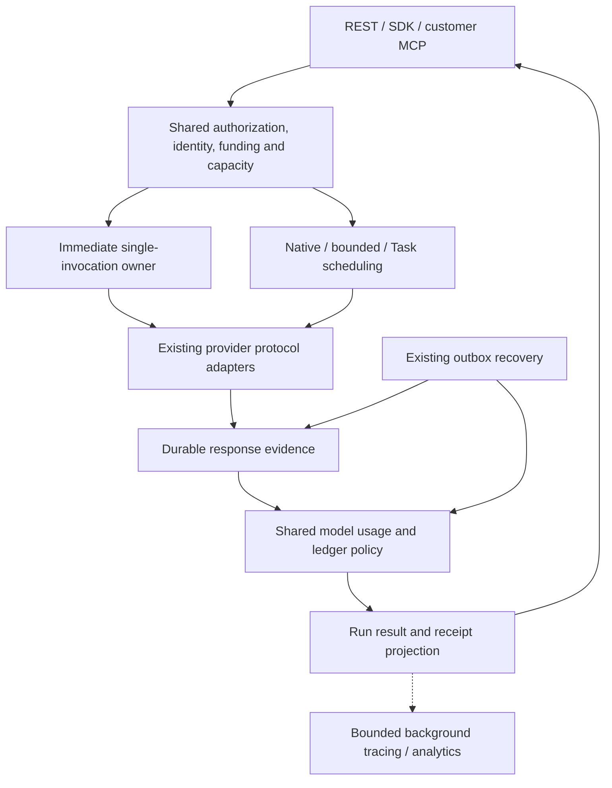

# Immediate inference: technical design and TODO

Status: proposed; application code is unchanged by this design. [Feature specification](immediate-inference-feature-spec.md) owns observable behavior. [Central TODO](../maintainers/TODO.md#direct-inference-latency-follow-up) owns project status; this document supplies the ordered implementation checklist and exit criteria. Read the current [decision implementation](../features/decisions/implementation.md), [streaming ownership](../features/api/streaming-implementation.md), [scheduling](../features/execution/scheduling.md), [billing](../features/billing/implementation.md) and [tracing](../features/observability/implementation.md) before implementing.

## Review decisions

The earlier chat design correctly removed the worker queue from direct model calls, but needs these adjustments:

| Earlier idea | Revised decision and reason |
| --- | --- |
| One admission commit and one combined response/settlement commit | Preserve **three short durable boundaries**: admission/dispatch intent, response evidence, final settlement/result. Combining the last two loses the response if the process dies or the transaction aborts during settlement. A savepoint helps recover a statement failure, not a connection/process failure. Remove round trips within each owner before weakening recovery. |
| Require exactly two database commands | A latency target is not a SQL-function quota. Keep typed domain orchestration in TypeScript, use transaction-aware helpers and focused set-based queries. Add a narrow SQL routine only if a measured round-trip bottleneck justifies it; never copy the whole authorization/billing engine into PL/pgSQL. |
| Synchronous special path plus optional queued passthrough | Single-call inference always executes immediately. Queueing belongs to native/bounded execution and Tasks. Keep recovery, not ordinary queueing, behind exceptional 202 receipts. |
| Add durable trace-export references | Reuse the bounded background trace exporter. Durable recovery/accounting already exists; reliable trace delivery is a separate feature, not a dependency of this latency project. |
| Higher async concurrency implies huge scale | Measure CPU, sockets, buffering, SQL throughput, locks, fairness, provider quotas and completions across replicas. Nonblocking HTTP alone does not establish throughput. |
| Preserve the exact queued head check for immediate calls | Propose separating immediate capacity admission from queued turn ordering. Otherwise an unstarted queue head can reject a call despite idle capacity and reintroduce poller dependence. Preserve weighted ordering for queued work; explicitly accept the cross-mode overload tradeoff before implementation. |

Three commits are the default design, not three expensive worker handoffs. They happen consecutively in one request owner around the actual provider I/O. Do not claim the absolute physical optimum; preserve the product's durability while removing demonstrated unnecessary work.

## Current flow and concrete sources

| Owner | Current behavior to inspect |
| --- | --- |
| [http.ts](../../packages/core/src/http.ts) | Authentication/rate accounting, body validation, preflight idempotency transaction, preparation, second identification, admission transaction, direct/async presentation; fingerprint includes async preference |
| [api-handlers.ts](../../packages/core/src/api-handlers.ts) | Selects direct admission using `!respondAsync(request)` |
| [inferences.ts](../../packages/core/src/inferences.ts) | Context/catalog preparation, current authorization, frozen financial terms, reservation, Run/outbox creation, then immediate capacity claim |
| [direct-inference.ts](../../packages/core/src/direct-inference.ts) | Calls `advanceInference` up to three times, then reloads the Run for presentation |
| [inference-engine.ts](../../packages/core/src/inference-engine.ts) | Repeated Run/invocation reads; prepared and dispatch-started commits; provider I/O; response commit; separate usage settlement and Run finish; per-call cancellation observation |
| [model-gateway.ts](../../packages/core/src/model-gateway.ts) | Shared model usage/accounting in `settleModelRequest`; native gateway authorization and native HTTP forwarding |
| [engine.ts](../../packages/core/src/engine.ts), [scheduling.ts](../../packages/core/src/scheduling.ts) | Shared organization/global locks, capacity/fairness and native placement currently reached by direct claims |
| [portable-dispatch.ts](../../packages/core/src/portable-dispatch.ts), [local-dispatch.ts](../../packages/core/src/local-dispatch.ts) | Durable queued work and recovery; direct healthy requests should not use their claim loop |
| [direct-inference-stream.ts](../../packages/core/src/direct-inference-stream.ts) | Transient output delivery, retained producer lifetime, bounded reader queue and replay |
| [REST host](../../apps/web/app/v1/[[...path]]/route.ts), [MCP host](../../apps/web/app/mcp/route.ts), [customer MCP bridge](../../packages/core/src/customer-mcp.ts) | REST currently schedules `dispatchRuns` after every successful mutation; MCP supplies a dispatch callback but its internal `handleApi` call lacks the background hook. Include both hosts in the lifetime/diagnostics refactor. |
| [decision-protocols.ts](../../packages/providers/src/decision-protocols.ts), [inference-stream.ts](../../packages/providers/src/inference-stream.ts) | Vendor preparation, HTTP, complete response assembly and usage normalization |
| [database wrapper](../../packages/db/index.ts) | Tenant transaction, maintenance lock, pool acquisition and after-commit callbacks |

The investigated external caller unconditionally selected async for ordinary inference, polled at roughly 500 ms, then separately fetched usage. Record the exact caller revision when integrating the change; do not copy its private source or fixtures into this repository. Fix its normal path to consume the completed receipt. A server improvement alone cannot remove an external polling loop.

The observed claim delays are evidence of the affected boundary, not proof of whether pool starvation, locks, query execution or the environment caused them. Instrument these separately. Avoid unproven JIT/configuration changes or unrelated query rewrites.

## One system, different execution owners



This is logical ownership inside the existing modular application. Do not create another service or public inference API. Native harnesses retain their protocol gateway and runtime; the diagram does not move native tool execution onto the API host.

### Refactor map

| Change | Location and interface | Other callers and safeguards |
| --- | --- | --- |
| Compose one immediate execution | Keep `direct-inference.ts` as coordinator; accept prepared invocation data and return typed completed/recovering results instead of an `unknown` envelope plus fixed three-advance loop | JSON and SSE share the coordinator; no duplicate provider call or accounting branch |
| Extract invocation lifecycle | Add a focused `inference-invocations.ts` only for preparation, dispatch-intent CAS, response evidence, validation and persisted recovery state currently embedded in `inference-engine.ts` | Immediate and bounded owners call the same functions; bounded context/tool turns remain in `bounded-decisions.ts` |
| Make model settlement composable | Extract `settleModelRequestInTransaction(tx, ...)` from `model-gateway.ts`, with the existing transaction-opening wrapper delegating to it | Native gateway keeps its current wrapper; direct finalization composes the same mutation with Run completion; native model completion must not finish its parent agent Run |
| Separate capacity from queued orchestration | Extract current capacity predicates and claim mutations from `claimRunInTransaction` into a focused domain owner, e.g. `execution-admission.ts` | All owners share caps/locks; queued owners additionally apply turn ordering and native placement. Immediate owners do not call `schedulerTurn`. The proposed policy change is explicit below. |
| Reuse identity and idempotency | Small shared helpers in the existing HTTP/domain boundary, no second auth or mutation framework | Leave unrelated file/object preparation and admin routes unchanged; only skip preflight work when the direct request has no external preparation |
| Present complete receipts | One typed projection used by direct completion, saved Run result and stream terminal events | SDKs, MCP, CLI, dashboard and billing use the same definitions; do not calculate money in a presenter |
| Observe active requests together | A bounded process-local cancellation observer for owned in-flight inference invocations | Poll current authority/cancel/deadline in batches using restricted, content-free access; no process-local state becomes durable execution authority |
| Compose host lifecycle hooks | REST and customer MCP pass the existing retained-background capability through to HTTP orchestration; distinguish producer retention/diagnostics from queue dispatch nudges | Do not wake `dispatchRuns` after a healthy immediate completion/replay. Preserve nudges for queued mutations and exceptional recovery using shared operation/effect knowledge, not duplicated URL tests or a new event bus. |

Keep `DecisionProtocol` and `ModelProtocol` distinct where they have different wire behavior. Share credentials, pricing arithmetic, usage models, failure policy and settlement through their existing owners; do not force native gateway streams and normalized decisions into a generic transport rewrite.

Use concrete exported types. Suggested domain interfaces below are contracts to implement, not new public DTOs:

```ts
// Reuse the repository's actual domain types; names below show the intended split.
type Admission =
  | { kind: 'dispatch'; permit: InvocationPermit }
  | { kind: 'replay'; receipt: ExistingInvocationReceipt };

// Runs inside the caller's tenant transaction; never opens another transaction.
admitImmediateInference(tx, principal, prepared, requestIdentity): Promise<Admission>;
persistInferenceResponse(tx, permit, responseEvidence): Promise<ResponseReference>;
settleModelRequestInTransaction(tx, settlement): Promise<ModelBillingReceipt>;
finalizeInference(tx, responseReference, validatedResult): Promise<CompletedInferenceReceipt>;

// Pure bounded work, outside SQL; binds its result to the saved evidence identity.
validateInferenceResult(responseEvidence, frozenConfiguration): ValidatedInferenceResult;

// Provider I/O is outside SQL; only the durable dispatch owner may call this.
executeInferenceInvocation(permit, signal, outputSink?): Promise<ProviderEvidence>;
```

`InvocationPermit` binds organization/Run/invocation IDs, ownership generation, immutable prepared request, frozen terms, exact credential binding and deadline. Credentials are ephemeral secrets, never serialized in a permit/receipt/log. A permit is internal, not client-supplied authority. Keep one completion projection, typed uncertainty states, and no `any`/double-cast escape hatches.

## Healthy request sequence

### Preparation without external side effects

Authenticate sufficiently to protect tenant/context reads, validate the request, resolve immutable definitions/context and prepare the exact provider body once. Reuse compiled validators. Catalog refresh and object reads remain outside lock-holding transactions. Fresh inline scoring requests need neither. Cache only immutable definitions/schema compilation and valid catalog metadata; never cache a stale spending permission, revoked key, decrypted customer credential or mutable context across requests.

Avoid repeated JSON canonicalization, schema compilation, payload construction and encryption of identical bytes. Keep provider-native payload semantics and protocol-owned routing/price ceilings. Context object I/O is legitimate additional work and must be measured separately.

### Transaction A: admit and commit dispatch intent

1. Take the existing idempotency lock and resolve a stored identity before creating new work. A replay must not redo expensive preparation unnecessarily; retain preflight lookup for object-backed preparation when it avoids real I/O.
2. Acquire shared admission/account locks in the order established by the existing owners. Perform current principal, organization, scope, workspace, context grant/expiry, exact BYOK, billing-hold and model checks after potentially blocking acquisition. Acquire the global capacity lock only for the final capacity decision/mutation. External credential refresh, context I/O and provider preparation happen before all admission locks; revalidate their binding/revision inside A. Recheck time-based expiry/deadline after waits. Reuse existing revocation locking/version guards; a transaction alone does not prevent a stale authorization read.
3. Freeze rates and reserve liability in that same transaction using the established financial lock order; check/mutate current account/fleet capacity under the global lock. This is one atomic commit, not permission to move financial lock acquisition after the global lock if existing owners acquire it first. Do not require a queued scheduler winner for immediate admission. Roll back rejected rows/holds on 429. Enumerate and exercise the shared lock order before changing it.
4. Create the Run, immutable configuration, gateway request, invocation, accepted event and idempotency identity together. Commit the invocation directly as `dispatch_started` for immediate execution. Keep `prepared` for queued/bounded steps where there is a genuine gap before authorization/dispatch.
5. Persist the existing recovery job, fenced through the bounded owner-completion window described below. It is recovery ownership, not a normal dispatch hop. Retain actual lease generation and compare-and-set guards.
6. Return the in-memory dispatch permit after commit; release the DB connection. Start provider I/O immediately with no intervening scheduler claim, catalog refresh or trace lookup.

Combining immediate preparation and dispatch intent sacrifices proof that a crash just after admission happened before HTTP dispatch: recovery must conservatively classify the committed intent as uncertain. This is deliberate; never replay it automatically. Only the original owner receiving a confirmed successful A commit may initiate the provider request. If commit acknowledgment is lost, read the saved identity to return its status; finding `dispatch_started` is not permission for that retry or recovery reader to invoke the provider.

### Provider I/O

Use the existing adapter and pooled HTTP transport, with the exact frozen request, credential and deadline. Disable automatic paid retries/fallbacks where they are not already disabled. Keep redirects and request/response limits enforced. No database client, tenant lock or global lock survives into this section.

Forward supported deltas immediately while assembling one bounded response. Ordinary scoring waits for its complete native result. Distinguish provider rejection, incomplete response, malformed usage and transport uncertainty using the protocol's evidence; an HTTP/network exception alone is not proof that no charge occurred.

Retain the existing disconnect semantics: delivery detaches, execution remains owned by the supported host lifetime and deadline. Register the **same producer promise** for JSON and SSE with the host lifetime before starting admitted work; awaiting it for JSON must not be its only lifetime protection. Do not start a second producer in the background hook. Explicit cancellation/authority revocation requests best-effort abort. A request handler cannot guarantee continuation after hard process death; durable recovery must handle it without dispatching again.

### Clock and ownership rules

- Keep the accepted Run execution deadline, HTTP host lifetime and recovery fence distinct. The existing 240-second direct ceiling inside the REST host's configured 300-second lifetime is only a starting margin: preparation, admission and finalization consume host time too. Each host must supply a verified lifetime budget; before A, refuse a new call if its requested execution window plus bounded completion allowance cannot fit. Do not silently shorten an accepted timeout or treat streaming/`after` as unlimited execution.
- Bound admission pool/lock waits and B/C persistence retries by the remaining host budget, using existing timeout facilities. Do not chain default 60-second SQL waits after consuming the nominal completion margin. Provider cancellation follows the accepted deadline; accounting may still finish afterwards, without reviving a timed-out Run.
- Set the recovery job's existing due/fence fields through that finite completion allowance, not merely a fixed five seconds after provider timeout. After B commits, an explicit failed C can make local finalization recovery due immediately. Recovery only consumes saved evidence or classifies an ambiguous invocation; it never dispatches the original request again. Late original-owner writes and recovery serialize on the same Run/invocation identity and converge idempotently.
- Graceful shutdown stops new admissions, retains registered producers through a bounded drain and then lets durable recovery handle unfinished identities. No new per-call heartbeat is needed solely for this short-lived direct owner. Hard shutdown remains a tested uncertainty case.

### Transaction B: preserve provider evidence

Seal and store the complete response or available incomplete evidence, normalized usage, provider request identity and provider timing. Seal bounded immutable bytes before acquiring SQL locks; transaction B checks ownership and retention before publishing them. Use the Run-first locking/fencing convention shared with cancellation and retention. A content purge wins; do not resurrect erased content. Record only accounting facts still permitted after purge.

Commit before validation/settlement code that can fail. The response remains recoverable even if later validation, ledger work or process execution fails. Publish any bounded-agent final event batch under its existing atomic evidence contract; direct deltas still do not become durable per-token events.

Distinguish transport evidence from successful normalization. Today `DecisionProtocol.invoke` can capture a raw response and then throw during schema/usage parsing; its diagnostic callback is not durable evidence. Extend that existing port with a typed failure/evidence result sufficient to preserve bounded available response data, HTTP/request identity and independently validated usage when decoding fails. Never invent complete usage from malformed fields. Keep this encrypted under existing content retention, never in ordinary logs; do not add a raw-response table or duplicate successful native payloads already retained as the result. Update the port's current diagnostics-only comment and its callers. Missing/oversized/malformed bodies retain only bounded evidence and explicit uncertainty, never an unbounded download or a paid retry.

After B, perform pure typed-output validation and receipt-data preparation outside SQL using the immutable response/configuration. Bind the prepared result to the saved invocation/evidence revision. Recovery uses the same pure function on saved evidence. A typed-output validation failure is a recorded outcome, not a reason to erase the provider response or skip accounting.

### Transaction C: finalize once

Re-read only current authority/lifecycle fields needed for cancellation, retention, deadline and ownership, and confirm the prepared result matches the saved evidence. Native output does not acquire an invented JSON-only contract. No schema compilation, provider decoding, external I/O or whole-response encryption runs while these locks are held.

Call the transaction-aware shared model settlement, then finalize Run state, settle the existing Run reservation, mark its recovery job done, publish required terminal events, and persist the completed receipt. They commit atomically. Return the receipt from this transaction; do not reload the full Run or query the billing report to produce the HTTP response.

Move the current `finish` logic into a transaction-aware helper. It must use the updated Run cost after model settlement, not a stale pre-settlement object. Repeated finalization returns the same recorded result without repeating charges or releasing capacity twice. A cancelled/timed-out Run still accounts for its accepted provider request; current terminal state must never be resurrected.

After commit and connection release, schedule existing trace/request-summary exports through the host lifecycle. Exporter failure does not affect result success. No new trace table/outbox is required.

## Response and client contract

Keep `InferenceResponse`, `RunResult` and `InferenceReceipt` as the public ownership chain. Extend `InferenceReceipt` with reusable OpenAPI components for invocation usage and billing; persist them in the same saved result. Do not return the organization wallet, another Run's costs, credential IDs beyond existing authorized fields, or unrestricted report data.

| Field under `result.inference` | Definition |
| --- | --- |
| `usage` | Normalized input/output/cached/cache-write counts with existing inclusion semantics, plus explicit completeness; unavailable counts are null, not zero |
| `billing` | Existing `charged_micro_usd`, `budget_cost_micro_usd`, `billing_mode`, `provisional`, provider estimate and provider-reported-cost fields from settlement; exact money representation and status retained |
| `timings_ms` | Existing timing object, with documented stage names; absent measurements remain absent |

Reuse existing exact money and cost-field schemas. Provider-reported account cost, upstream inference cost and estimated provider cost overlap; never sum them. Langfuse native cost continues to be the Macrofold customer charge. BYOK model charge is zero even when its actual provider account cost is positive. Streaming and non-streaming use identical accounting.

Expose invocation-specific billing to the authorized submitter/result reader under existing Run permissions, without granting organization-wide billing scope. Replays and result GETs still enforce current tenant/resource authority. Keep the existing response scope behavior unless a separate security change is required; streaming still needs `runs:read`.

On this endpoint remove `Prefer: respond-async`, its `Preference-Applied` handling, and `queue_timeout_seconds` from the public request shape. Reject the known async header early even after removing its OpenAPI enum; headers otherwise may not be validated as body properties are. Remove the async preference from execution fingerprints; no compatibility alias is required. Preserve the current `stream` fingerprint behavior: changing stream/body is a different execution request and conflicts. A malformed/unsupported header never creates a second Run for a previously used key.

After durable admission, responses/errors must retain `run_id` when known and always preserve the submitted idempotency key through SDK errors. Nonterminal recovery receipts may use `status: running` plus a documented recovery reason; do not fabricate `queued` for a call that was already dispatched. HTTP 202 during recovery is not successful completed output. Pre-admission failures are safe to retry under the same identity; ambiguous accepted execution must be retrieved, not resubmitted under a new identity.

Server-side maximum direct duration remains 240 seconds initially, matching current app/client lifetime margins. Change the obsolete advice to use async for longer requests. Explain the supported limit and separately available agent/task APIs without recommending those as semantically identical one-call proxies. A future longer single-call path must configure and verify API/load-balancer/SDK/provider timeouts together. Streaming does not bypass hosting duration limits.

Update all five SDKs via the generators. Maintained transports must preserve mutation identity, finite timeouts, and the distinction between HTTP rejection, terminal failed results, interrupted streams and recovery receipts. Do not add an invisible wait loop to `inferences.create`; consumers use the returned result directly. MCP uses the same domain/HTTP policy, retains current submission credential rules, and rejects unsupported direct streaming; it must not secretly add async preference to fit a client timeout. Update tool descriptions accordingly.

## Admission and scale

### Shared policy, specialized work

Immediate inference has no machine, Host assignment or Worktree writer. Move shared account/fleet checks out of native placement. Keep one definition of active occupancy and entitlement across native, bounded and direct execution. Native/bounded claims still perform their extra placement/order work. Direct calls must not depend on a per-process worker dispatch slot such as `DISPATCH_INFERENCE_CONCURRENCY`.

Retain the existing global capacity lock initially. Under it, use indexed current active occupancy and account/fleet entitlements. Do not run native placement/Host joins, select queue heads or scan terminal history to decide a direct request. Reuse one capacity predicate and claim mutation; only queued owners additionally call `schedulerTurn`/`recordTurn`. Immediate admissions do not advance the queued service clock. Existing partial indexes are the first optimization; this change does not require a new ready-head projection.

**Proposed policy change, to accept with the implementation plan:** weighted service orders queued work; immediate work is work-conserving admission governed by current caps/rates/funding. The former proposal required the direct request to be the exact queued winner. With an older eligible bounded Run and no poller progressing it, that rejects immediate requests indefinitely even with unused capacity. Testing with an empty queue would miss the dependency.

This separation preserves queued weighting among queued candidates and all strict capacity/accounting safeguards, but deliberately does **not** preserve weighted start ratios between queued and immediate traffic. Under sustained saturation immediate traffic can consume the shared lightweight allowance and delay bounded work; the reverse can also fill capacity. Do not describe account caps as a starvation guarantee. Measure both directions and one hot tenant. If guaranteed per-mode progress or weighted cross-mode admission is required, agree on a finite reserved-capacity allocation before implementation; it trades some work conservation for that guarantee. Do not silently add a second queue, retry loop or permit allocator. This policy choice belongs in the canonical scheduling/decision guides when the proposal is accepted, not as an undocumented optimization.

Do not remove serialization to win a benchmark. Track global lock hold/wait separately. If measured lock throughput cannot support the acceptance load after query simplification, stop claiming scale: record the measured ceiling and propose a separately reviewed sharded capacity-allocation design. Preallocated permits/escrow have real crash, fairness and financial consequences and are not required speculatively in this project.

### Resource budgets

| Resource | Required treatment |
| --- | --- |
| Open provider requests | Async I/O across replicas; finite process in-flight budget from measured socket/memory/CPU behavior; reserve before durable dispatch, release on all exits. Resolve completed replay before requiring a new execution permit; existing rate/auth protection still applies. |
| Database connections | Held only for short queries/transactions; sum domain/auth/credential pools across replicas; preserve independent credential refresh |
| Admission vs completion | Bound admission pressure so it cannot occupy every connection while response persistence, cancellation and settlement need service; use bounded admission concurrency within the shared pool first, not another oversized pool |
| Per-key HTTP rates | Keep abuse protection distinct from provider concurrency. A caller's 1,200-write/minute default can cap inference at 20/s regardless of free execution capacity; measure and document overrides or a dedicated inference bucket if the acceptance workload requires it. Do not secretly bypass rate accounting. |
| Account/fleet limits | Existing plan entitlements and deployment ceilings remain authoritative. Current 2,000-lightweight default is not proof of a 10,000-concurrent deployment; load fixtures configure and record sufficient capacity explicitly. |
| Memory | Bound request body, complete response and stream queues; release duplicate raw/normalized/ciphertext buffers promptly. A 512 KiB response across 10,000 calls is about 4.9 GiB before object overhead; a 2 MiB queue per stream can add about 19.5 GiB. Distribute load and test slow readers. |
| Provider quota | Respect actual RPM/TPM/concurrency and upstream 429s. Do not convert provider throttling into an opaque retry queue or claim it as Macrofold compute latency. |
| Maintenance/recovery | Independent bounded loops; synchronous success does not wait for them, but accepted uncertain work must eventually reconcile. |

No arbitrary new default such as “10,000 per process.” Publish measured per-instance capacity and the deployment size needed for the target. Horizontal HTTP scaling does not automatically scale a hot organization wallet row, global admission lock or database writes.

### Cancellation without one query loop per call

The current non-overlapping per-call 500 ms poll still produces roughly 20,000 checks/second at 10,000 active calls. Replace it for owned direct invocations with one shared observer per API process, registered only while calls are active.

Batch IDs in bounded pages, select only cancellation/deadline/current-actor-authorization facts, and return IDs/booleans rather than private request content. Use existing restricted reporting patterns for cross-tenant facts or correctly scoped tenant batches; never elevate the serving role. Poll at the current 500 ms cadence initially. Coalesce repeated identity lookups for the same principal, but retain each Run's workspace/credential/context restrictions; one authorized Run cannot authorize another. Retain a bounded scan cursor, and measure a complete sweep against the revocation/cancel requirement. A process-local direct notification can accelerate local cancel but cannot replace cross-instance observation. Do not add one polling timer, database listener or persistent DB connection per invocation; a per-call deadline timer/AbortController is still appropriate.

Remove completed registrations immediately. Stopping observation must not await an unrelated batch before committing response evidence. In-flight observations cannot revive a completed request or mutate its settled state. Finalization rechecks current authoritative lifecycle/permissions. On repeated observation failure, abort affected active transports conservatively and preserve uncertainty. Do not increase revocation latency silently to satisfy throughput.

### Deployment and measurable scale

Run ready API instances near the primary database, warm bounded connection pools, and reuse the existing upstream HTTP connection pool. Do not add a fresh HTTP Agent for every fixed-provider call. A ready standalone deployment can use the same application artifact; no alternate domain engine is required. Keep native compute off the API host.

Remove unconditional dispatch nudges from healthy inference/replay in the REST and MCP composition paths. Moving expensive work after the response does not make its database/CPU load disappear: at high request rates it can still delay subsequent calls and finalization. Pass the existing background lifecycle capability into the MCP-to-HTTP bridge too, so non-authoritative request logging does not remain synchronous there. Audit actual host call sites, not just `direct-inference.ts`.

Measure two different targets:

- **Fast calls:** sustainable requests/second for small scoring responses with fixed 0/300/500 ms upstream fixtures. Show server overhead and end-to-end latency.
- **Many waiting calls:** at least 10,000 concurrent synthetic provider requests across multiple API replicas, with sufficient declared account/fleet quotas and provider fixture capacity. Show success rate, memory, sockets, event-loop delay, finalization throughput and recovery. This is not 10,000 requests/second.

Capacity planning uses `in_flight ≈ arrival_rate × mean_provider_duration`. For example 1,000 calls/second and 0.5-second providers means roughly 500 provider calls in flight; 10,000 in-flight calls at that duration implies about 20,000 calls/second, far more database work. Record both axes; never report concurrency alone as certified throughput.

Use measured bottlenecks to set deployment ceilings and headroom. Cold-start and provider-network delay must be visible separately. Request duration, memory, sockets and instance limits depend on the host; verify the actual deployment, not a vendor's maximum marketing number. [Vercel limits](https://vercel.com/docs/functions/limitations) explicitly include response/stream time in the function lifetime. [node-postgres transactions](https://node-postgres.com/features/transactions) require a single client per transaction, not a client for the entire HTTP call.

## Failure and recovery matrix

| Boundary | Required outcome |
| --- | --- |
| Invalid/revoked/unsupported request before A | HTTP error; no provider call, Run or retained funds |
| A rolls back | No provider call; retry with the same key is safe |
| A commit acknowledgment lost | Resolve identity; do not dispatch without confirmed ownership |
| Complete upstream body, local normalization fails | Persist bounded failure evidence and valid usage independently; return a typed failure, not an apparent free request or another provider dispatch |
| Process dies after A, before known response | Recover the same invocation as uncertain after its fenced deadline; no automatic provider replay |
| Provider rejects or returns incomplete evidence | Preserve the adapter's usage/outcome evidence and existing provisional accounting; do not infer zero usage from a generic exception |
| Provider completes, B fails | Preserve identity, attempt only bounded idempotent evidence persistence when safe; expose recovery/uncertainty, never call provider again |
| B commits, validation/settlement/process fails | Saved evidence survives. Recovery runs C using it; no second provider call |
| C commit acknowledgment lost | Read same identity/settlement result; unique financial/request keys prevent duplicate charges |
| C commits, HTTP delivery fails | Same-key replay returns persisted terminal receipt |
| Cancel/deadline/revocation races response | Account for dispatched work; current lifecycle prevents successful publication/revival; preserve permitted late evidence |
| Purge races response | Do not reinsert deleted content; retain only required financial identity/facts |
| Duplicate worker/Workflow recovery | Fenced response/finalization operations converge; no ownership steal while the direct owner is live |
| Trace exporter unavailable | Complete the ordinary result; bound/drop diagnostics according to existing policy, no ledger impact |
| JSON client disconnect or host shutdown | Retain the original producer through the supported bounded host lifetime; otherwise recover its durable identity without provider replay |

Recovery liveness and capacity reclamation are separate from client delivery. Never free uncertain external liability merely because an HTTP socket closed. Document how each existing terminal/recovery policy releases execution slots while preserving unresolved financial facts; test that a lost direct owner cannot leak active capacity indefinitely or be reclaimed early enough to dispatch twice. Do not invent exact-once provider execution guarantees after a network ambiguity.

## Measurement contract

Use monotonic time for durations within one process. PostgreSQL `now()` is transaction-start time and cannot substitute for commit elapsed time. Do not subtract wall clocks from different hosts as precise stage timings.

Record non-content metrics for authentication, validation/preparation, pool acquisition, lock wait, database query execution/commit, provider transport, response evidence, final settlement and response serialization. Query durations may include lock time; do not sum overlapping measurements. Existing provider timing includes network/response parsing, not provider-only GPU time. Trace export, SDK parsing and caller follow-up requests must be shown separately.

Define added server overhead as request-handler elapsed through ready-to-send final response minus measured provider adapter duration; retain a separate caller stopwatch including network and parsing. Stored final receipts cannot contain their own future commit/delivery duration. Persist known stages, publish final request metrics through background observation, and label any response-only final timing as such rather than issuing another measurement write.

Warm inline requests target p50 ≤10 ms, p95 ≤25 ms and p99 ≤50 ms added server overhead within the declared sustainable envelope. These targets are unverified. The earlier local warm SELECT measurements (~0.55 ms for SELECT 1 and ~2.18 ms for an authorization-shaped read) excluded durable writes, runtime RLS, concurrency and cloud networking; they are not proof of those targets.

## Implementation checklist

All boxes start open. Preserve unrelated work and the running preview. Before implementation, follow repository startup/rebase guidance and record the intended base/current diff. This design is documentation-only until the user authorizes implementation.

### I0 — Establish fixtures and baseline

- [ ] Inventory every `createInference`/`respondAsync` producer and consumer, including REST/MCP lifetime and dispatch hooks, generated SDK resources, maintained transports, public examples, dashboard/CLI presentation and external caller guidance. Exclude generated files from hand editing.
- [ ] Read the existing direct-inference, streaming and provider-native TODOs; carry their missing acceptance into this project without marking it done.
- [ ] Add/extend isolated instrumentation and a deterministic loopback provider using existing test helpers. No real customer data, real keys, production database or main preview mutations.
- [ ] Record matched immediate and forced-async baselines, SQL/transaction counts, pool/lock time, total latency and full build/configuration identity. Confirm the proposed benchmark can detect an injected worker-claim delay and an injected database delay separately.
- [ ] Define sustainable offered load, account distribution, payload sizes, topology and provider fixture latencies before comparing percentiles. Do not use a closed-loop-only test that hides backlog.

Exit: a reproducible before/after workload and observable bottlenecks, with no unsupported diagnosis of historical claim internals.

### I1 — Extract shared lifecycle without changing behavior

- [ ] Extract transaction-aware model settlement; keep the existing wrapper for native callers and reuse all money/usage/circuit-breaker logic.
- [ ] Extract invocation preparation, response persistence, validation and finalization from the phase engine into focused functions. Preserve existing encrypted evidence, retention guards and late-response semantics.
- [ ] Extract shared capacity predicates/claims without changing native placement or queued fairness. Document and test lock order against reservation, cancellation, completion and maintenance before optimizing it.
- [ ] Make bounded normalization-failure evidence explicit at the existing decision-provider port; reuse encrypted response storage, usage validation and retention. Keep native gateway wire handling separate.
- [ ] Keep provider ports/types and caller-specific orchestration distinct. Delete displaced duplicate logic rather than leaving two implementations.
- [ ] Run affected native gateway, inference, bounded-agent, ledger, cancellation and scheduling regressions. No runtime image change is necessary solely for these control-plane extractions.

Exit: sibling behaviors remain unchanged and each financial/lifecycle rule has one owner.

### I2 — Implement the immediate request lifecycle

- [ ] Compose A → provider → B → C in `direct-inference.ts`; remove its fixed-count phase loop and final full-Run reload.
- [ ] Create immediate dispatch intent in admission, keeping sealed request/digests/frozen terms/current authority and fencing atomic. Keep queued/bounded preparation behavior intact.
- [ ] Avoid generic preflight/re-identification work only where the shared authority/idempotency guarantees remain identical; do not bypass replay checks or post-preparation revocation.
- [ ] Use one committed response checkpoint before all settlement; finalize model usage, ledger, terminal Run and receipt in one subsequent transaction.
- [ ] Prepare encrypted evidence and pure output validation outside SQL locks. Revalidate authority/expiry after blocking acquisition and check the evidence identity at final publication.
- [ ] Preserve evidence-only recovery on a failed finalization and retain idempotency in all failures after admission.
- [ ] Route JSON and direct SSE through one lifetime-retained producer. Bound preparation/admission/completion against the actual host budget, retain explicit Run deadlines, and fence recovery through the completion allowance. Add no per-token SQL or trace calls.
- [ ] Make the healthy request independent of poller/Workflow availability. Recovery jobs stay durable and cannot dispatch the same intent again.

Exit: actual HTTP fixtures complete with no worker running and one provider call; fault injection proves all three boundaries.

### I3 — Remove scale bottlenecks and validate admission

- [ ] On acceptance of the proposed policy, remove queue-head/turn selection and native placement/history work from immediate claims; measure current active-count plans under the restricted runtime role on populated fixtures.
- [ ] Preserve global/account caps and transaction fencing across all owners, and weighting among queued candidates. Test direct calls with eligible older queued work and no poller, then measure both directions of cross-mode competition under saturation. Do not claim guaranteed per-mode progress without an approved allocation policy.
- [ ] Bound per-process admission pressure and in-flight HTTP memory/sockets; leave connection headroom for B/C and cancellation. Refuse new work before dispatch when genuinely saturated.
- [ ] Implement the shared cancellation/authority observer; exercise multiple tenants and API instances, disconnected readers, observation failure and cleanup without a completion barrier.
- [ ] Audit inference HTTP rate defaults and SDK retry delays against the declared workload. Configure measured limits without weakening funding, provider or account policy.
- [ ] Check that tracing disabled, slow, and unavailable does not add attribution lookups or exporter waits on the healthy critical path; reuse existing bounded export hooks.
- [ ] Remove ordinary inference/replay dispatch nudges at all host entry points; retain queued-mutation and exceptional-recovery nudges. Verify no hidden background scheduler scans per completed inference.

Exit: mixed workloads progress within the declared sustainable envelope, overload competition is reported honestly, active capacity returns to baseline, and locks/pools/observer overhead stay bounded as history and concurrent calls grow.

### I4 — Publish the complete API and client contract

- [ ] Update OpenAPI for immediate-only submission, async-header rejection, removed queue-only input, complete receipt usage/billing, recovery statuses/reasons and current direct timeout. Do not alter native/bounded schemas accidentally.
- [ ] Use the same receipt projection for immediate result, saved result and final SSE event. Prove run-scoped callers receive only their own accounting without organization reporting scope.
- [ ] Generate all SDKs with `pnpm sdk:generate:all`; update maintained JSON/SSE transports and SDK examples. Verify no normal inference helper polls or fetches billing automatically.
- [ ] Update customer MCP tool descriptions/wiring, pass through retained background execution/diagnostics hooks, and ensure current credential-kind restrictions and streaming support remain truthful.
- [ ] Update Macrofold's external caller integration brief: remove forced async, consume `result.inference` immediately, record caller total separately from provider duration, use embedded usage/billing, recover only exceptional 202s with the same identity. Apply changes in another checkout only with authorization; otherwise provide the exact handoff and leave cross-app acceptance open.

Exit: REST and all supported client surfaces expose the same behavior with no hidden async compatibility branch.

### I5 — Verification and production-scale evidence

- [ ] Deterministic HTTP tests: Jev and generative native/typed input, success/refusal/invalid output, header/timeout/stream capability rejection, current authority, exact BYOK, no-worker operation and complete receipts.
- [ ] Concurrent/failure tests: duplicate submissions, each A/B/C crash boundary using actual fixture process termination, lost commit acknowledgment, cancellation/revocation/purge races, model failure stop controls, missing/malformed usage, normalization/settlement failure and recovery from another API/worker process. Include JSON disconnect, graceful drain, slow B/C past the provider deadline, expired grants after lock waits, and completed replay while new execution capacity is full.
- [ ] Shared-boundary regressions: native gateway streaming, multi-call bounded accounting/tool validation, queued fairness and documented cross-mode overload behavior, worktree exclusion, strict aggregate caps, financial balanced journals and one settlement per invocation.
- [ ] Stream tests: early output before provider completion, slow reader/overflow, detach, explicit cancel, malformed/partial provider stream, terminal event after settlement, retained result and no per-delta database writes.
- [ ] Run all-five-SDK actual HTTP/SSE acceptance and customer MCP integration; inspect emitted headers, error identities, timeouts and serialized decimal money, not just generated compilation.
- [ ] Load in isolated databases and independent API replicas: ramp fast-call arrival rate; run 10,000 in-flight delayed provider calls with declared increased fixture limits; vary tenants and one hot tenant, retained Run history, full-size bodies, cancellation, maintenance and tracing failure. Verify generator/upstream fixture capacity so it cannot become an unreported bottleneck.
- [ ] Use open-loop arrivals and report offered/accepted/completed/rejected rates, p50/p95/p99, throughput, pool/global/org lock waits, CPU/event-loop lag, memory/socket counts, finalization/recovery lag and reservation drift. A timeout or high rejection rate is not a scale pass. Repeat the acceptance load below measured saturation with documented headroom.
- [ ] Run small authorized live provider checks after deterministic acceptance; distinguish live latency from local fixture evidence. Use the repository spending policy and never infer unlimited spend from keys or load-test configuration.
- [ ] Verify the actual supported hosted topology, request lifetime, connection budgets and same-region database behavior. If infrastructure/budget prevents the target, record the exact measured ceiling and remaining hosted gate; do not silently lower the target or claim certification.

Use [TESTING.md](../../TESTING.md) and existing `pnpm test:domain`, `pnpm test:load`, `pnpm test:sdks`, `pnpm check` and build commands as applicable. Match focused test file names after implementing; do not invent a nonexistent benchmark command in public docs. Ordinary CI uses synthetic providers. Document full runtime/native checks only when the refactor actually changes those boundaries.

### I6 — Documentation, migration and coordinated release

- [ ] Update the decision public guide/implementation, API conventions/quickstart/OpenAPI, streaming guides, SDK reference/examples, customer MCP instructions, billing usage semantics, observability, architecture/codebase map, scheduling and scaling owners. Explain immediate inference separately from queued agent work.
- [ ] Remove examples that routinely call `runs.wait` after a completed inference; keep explicit recovery examples. Keep developer/internal instrumentation separate from customer integration steps.
- [ ] Reconcile stale capacity documentation with actual `capacity.ts` and pool settings while updating affected sections; do not present old per-process defaults as current.
- [ ] If a migration is needed, use a new forward migration for justified indexes/current projections and restricted privileges. Existing Run/invocation/gateway/idempotency records remain the source of truth. Rehearse against populated disposable fixtures; no destructive clearing of developer data.
- [ ] Coordinate API, SDK, MCP, Workflow/poller and external caller versions. Stop accepting old async inference submissions before activation; drain or safely finish previously accepted local work with a compatible executor. Do not remove the shared recovery engine because ordinary inference no longer queues.
- [ ] For rollback, pause new admission and preserve compatible recovery/accounting readers. Never roll back to code that replays committed dispatch intent or cannot read new receipts. No force-reset of local fixtures or ledger history.
- [ ] Update central TODO checkboxes only with actual evidence, update current-state docs only as behavior ships, run `pnpm docs:generate` for published changes and `pnpm docs:check`, inspect the full affected diff and record remaining release gates.

Exit: source, generated clients, user guides and deployed behavior agree; delivered scope is backed by correctness, caller and scale evidence.

## Decisions deferred until evidence requires them

- Global capacity sharding/leased permits: only if the shortened global lock is a measured bottleneck at the target; requires explicit fairness, lease-loss and accounting design.
- Reserved capacity between immediate and queued lightweight work: only if guaranteed per-mode progress is a product requirement; do not silently add it or claim current shared caps provide it.
- Larger direct timeout: only with matched host/client lifetime support; no implicit conversion to queued execution.
- Durable tracing export: outside this project; current bounded best-effort diagnostics remain explicit.
- A separate deployable proxy: unnecessary initially. The same modular application can scale horizontally; extract deployment packaging only if measured operational isolation requires it.
- Multi-region write admission, wallet escrow and provider-side idempotent retries: no speculative implementation. Preserve current guarantees and report the actual limiting resource.

The scheduling separation above is a material policy proposal, not a shipped behavior: accepting implementation should include accepting that overload tradeoff. If weighted cross-mode service or guaranteed queued progress is required instead, resolve the allocation policy first. Sustainable throughput on the selected production topology remains an acceptance unknown; this design defines how to measure it rather than assuming a universal constant.
